# Scripts UNIGEO / CEMTEC — Monitoramento meteorológico de Mato Grosso do Sul

Produtos meteorológicos gerados a partir dos dados horários das **estações automáticas do INMET**, com **planilhas Excel** e **mapas** (pontuais e interpolados). Nasceu para Mato Grosso do Sul e continua com MS como padrão em tudo, mas **o estado é um parâmetro**: `--uf` nos produtos, seletor no painel, hoje com os 25 estados que têm estação automática operante.

| Produto | O que gera |
|---|---|
| [`relatorio_inmet`](#produto-relatorio_inmet) | Extremos de temperatura, umidade e rajada e chuva acumulada de cada estação: planilha Excel e mapas |
| [`risco_fogo`](#produto-risco_fogo) | Risco meteorológico de fogo pela regra 30-30-30, avaliada hora a hora: planilha Excel e mapas de nível de risco |

Ao lado dos produtos ficam:

- **o painel** ([Explorador (Streamlit)](#explorador-streamlit)), para olhar o observado e a previsão em mapas navegáveis ou no formato do boletim;
- **os coletores** ([Banco e coletores](#banco-e-coletores-servidor)), que guardam no banco da UNIGEO as leituras do INMET, a previsão do Open-Meteo, os pluviômetros do CEMADEN e a contagem dos raios do GOES.

Desenvolvido pela equipe de meteorologia do **CEMTEC** — Centro de Monitoramento do Tempo e do Clima de Mato Grosso do Sul (SEMADESC).

---

## Sumário

- [Como usar](#como-usar)
  - [Primeiros passos](#primeiros-passos)
  - [Como rodar um produto](#como-rodar-um-produto)
  - [Produto `relatorio_inmet`](#produto-relatorio_inmet)
  - [Produto `risco_fogo`](#produto-risco_fogo)
- [Requisitos](#requisitos)
- [Instalação](#instalação)
- [Como atualizar](#como-atualizar)
- [Configuração](#configuração)
- [Testes](#testes)
- [Banco e coletores (servidor)](#banco-e-coletores-servidor)
- [Explorador (Streamlit)](#explorador-streamlit)
- [Novos produtos](#novos-produtos)
- [Estrutura do repositório](#estrutura-do-repositório)

---

## Como usar

### Primeiros passos

1. Instale o Python e as dependências (veja [Instalação](#instalação)).
2. Configure o token do INMET no arquivo `.env` (veja [Configuração](#configuração)).
3. Escolha o produto e o período, e rode o `main.py` como explicado abaixo.

### Como rodar um produto

Todos os produtos são gerados pelo mesmo arquivo, o [`main.py`](main.py). Há duas formas de dizer **qual produto** gerar e **de quando** são os dados.

**1. Pela linha de comando** (sem editar nada):

```bash
python main.py --produto relatorio_inmet --dataini 15/09/2026
```

| Opção | O que faz | Exemplo |
|---|---|---|
| `--produto` | Escolhe o produto | `--produto risco_fogo` |
| `--dataini` | Data inicial (DD/MM/AAAA) | `--dataini 15/09/2026` |
| `--datafim` | Data final; se omitida, igual à inicial | `--datafim 20/09/2026` |
| `--hrini` | Hora de início, no horário do estado (0 a 24) | `--hrini 8` |
| `--hrfim` | Hora de fim, no horário do estado (0 a 24) | `--hrfim 18` |
| `--tempo-real` | Últimas 24 horas até o momento em que roda | `--tempo-real` |
| `--hrtodas` | Só para o `risco_fogo`: gera o mapa de todas as horas | `--hrtodas` |
| `--retirar` | Tira estações dos mapas de uma variável (veja abaixo); repita para outra variável | `--retirar "Chuva: Campo Grande; A702"` |

As horas aceitam `8`, `08h` ou `08:00`. Para ver todas as opções: `python main.py --help`.

**2. Editando o topo do `main.py`** e rodando só `python main.py`:

```python
PRODUTO = "relatorio_inmet"
DATA_INICIAL = date(2026, 8, 1)
DATA_FINAL = date(2026, 8, 31)
HORA_INICIAL = None  # opcional: hora de início (0 a 24); None = 00 h
HORA_FINAL = None    # opcional: hora de fim (0 a 24); None = 24 h
RETIRAR = {}         # opcional: estações fora dos mapas, por variável (veja abaixo)
```

O que a linha de comando não informar é lido dessas variáveis.

#### Estações retiradas dos mapas

Quando uma estação manda dado errado (o sensor com defeito) e a correção do INMET ainda não chegou, ela pode sair dos mapas de uma variável: do ponto, do ranking e da interpolação. **A planilha continua com todas**, e é nela que se confere o dado que saiu do mapa. A lista é por variável porque quem falha é um sensor: um pluviômetro entupido não estraga a temperatura da mesma estação.

```bash
python main.py --tempo-real --retirar "Chuva: Campo Grande; Dourados" --retirar "Temperatura: A702"
python main.py --produto risco_fogo --tempo-real --retirar "Risco: A702"
```

Ou, no topo do `main.py`, `RETIRAR = {"Chuva": ["Campo Grande", "Dourados"], "Temperatura": ["A702"]}`; o `--retirar`, quando vier, vale no lugar dela. A estação vale pelo nome, sem ligar para acento e maiúscula ("ponta pora" acha Ponta Porã), ou pelo código do INMET, e as de fora do estado que seguram a borda da interpolação também podem sair. As variáveis são **Temperatura**, **Umidade**, **Vento** e **Chuva** no `relatorio_inmet` (a de Temperatura vale para a máxima e a mínima) e **Risco de Fogo** (ou só "Risco") no `risco_fogo`, onde a estação sai das três medidas da regra. O terminal diz quem saiu de cada mapa, e avisa a estação que não se achou e a variável que o produto não mapeia.

#### Os três modos de tempo

O modo é definido pelas datas:

| Modo | Como pedir | Janela de tempo (horário do estado) |
|---|---|---|
| **Data específica** | `--dataini 15/09/2026` (ou `DATA_INICIAL` igual a `DATA_FINAL`) | O dia, da 00 h às 24 h |
| **Estado** | `--uf MS` | Os 25 com shapefile em `shp/` — todos os que têm estação operante (padrão: MS). Troca junto o **fuso**, que decide onde o dia começa, as estações, os shapefiles e o enquadramento dos mapas |
| **Período** | `--dataini 01/08/2026 --datafim 31/08/2026` (ou datas diferentes) | Da 00 h da data inicial às 24 h da data final |
| **Tempo real** | `--tempo-real` (ou as duas datas `None`) | As últimas 24 horas, até o momento em que roda |

Com `--hrini` e `--hrfim`, a janela passa a começar e terminar nessas horas — por exemplo, `--dataini 14/09/2026 --hrini 8 --datafim 15/09/2026 --hrfim 8` cobre das 08 h de 14/09 às 08 h de 15/09. O modo continua definido pelas datas (mesmo dia = data específica; datas diferentes = período). As horas não valem com `--tempo-real`.

**`--produto` e o modo de tempo são independentes.** O `--produto` diz *o que* gerar; `--dataini`/`--datafim` ou `--tempo-real` dizem *de quando* são os dados. Qualquer produto pode ser combinado com qualquer modo que ele aceite:

| Produto | Data específica | Período | Tempo real |
|---|:---:|:---:|:---:|
| `relatorio_inmet` | ✅ | ✅ | ✅ |
| `risco_fogo` | ✅ | ✅ | ✅ |

#### Onde ficam os resultados

Cada execução cria uma pasta própria dentro de `saida/`, separada por produto e por modo: `saida/<produto>/<modo>/<datas>/`. O nome da última pasta indica a janela consultada, no horário do estado:

| Consulta | Pasta |
|---|---|
| Data específica | `dia/20260915/` |
| Período | `periodo/20260801_a_20260831/` |
| Com horas | `periodo/20260914_08h_a_20260915_08h/` |
| Tempo real (rodado às 16h10 de 16/09) | `tempo_real/20260916_1610/` |

O conteúdo de `saida/` fica fora do controle de versão. O que cada produto grava nessa pasta está na seção **Saídas** de cada um, abaixo.

---

### Produto `relatorio_inmet`

Relatório de extremos e chuva das estações automáticas do INMET no estado escolhido.

#### O que calcula

Para cada estação automática do estado, na janela consultada:

| Variável | O que é calculado | Aba da planilha |
|---|---|---|
| Temperatura mínima | Menor valor, com data e hora | `Temp_Min` |
| Temperatura máxima | Maior valor, com data e hora | `Temp_Max` |
| Umidade relativa mínima | Menor valor | `Umidade` |
| Rajada de vento | Maior rajada (km/h) e a direção registrada no mesmo horário | `Vento` |
| Chuva | Acumulado na janela (no tempo real, em várias janelas) | `Chuva` |

Passo a passo de uma execução:

1. Consulta a lista de estações automáticas do INMET e filtra as do estado, descartando as que estão em pane.
2. Baixa a série horária de cada estação pela API do INMET.
3. Calcula os extremos e os acumulados de cada variável.
4. Gera a planilha Excel com uma aba por variável, ordenada pelo valor.
5. Gera os mapas com o limite estadual, os municípios, o ranking dos 5 maiores (ou menores) valores e os logos institucionais.

#### Como rodar

```bash
python main.py --produto relatorio_inmet --dataini 15/09/2026                                   # data específica
python main.py --produto relatorio_inmet --dataini 01/08/2026 --datafim 31/08/2026                  # período
python main.py --produto relatorio_inmet --dataini 14/09/2026 --hrini 8 --datafim 15/09/2026 --hrfim 8  # com horas
python main.py --produto relatorio_inmet --tempo-real                                          # tempo real
```

#### Tempo real, data específica e período

| | Tempo real | Data específica | Período |
|---|---|---|---|
| **Extremos** (temperaturas, umidade e rajada) | Últimas 24 h | O dia (00 h às 24 h do estado) | Da 00 h da data inicial às 24 h da data final |
| **Chuva na planilha** | Hoje (desde a 00 h do estado), 12 h, 24 h, 48 h e 72 h | Total do dia (`Acumulado Dia`) | Total do período (`Acumulado Período`) |
| **Mapas de chuva** | 24 h, 48 h e 72 h | 24 h | Período |
| **Total de mapas** | 15 | 11 | 11 |

Quando a consulta usa horas (`--hrini`/`--hrfim`), a chuva aparece como `Acumulado Período`, com a duração em horas no título do mapa.

#### Saídas

```
saida/relatorio_inmet/dia/20260915/
├── Relatorio_MS_20260915.xlsx
└── mapas/
    ├── Mapa_Temp_Min_MS_20260915.png
    ├── Mapa_Temp_Min_MS_20260915_interpolado.png
    ├── Mapa_Temp_Max_MS_20260915.png
    ├── Mapa_Temp_Max_MS_20260915_interpolado.png
    ├── Mapa_Umidade_MS_20260915.png
    ├── Mapa_Umidade_MS_20260915_interpolado.png
    ├── Mapa_Chuva_24h_MS_20260915.png
    ├── Mapa_Chuva_24h_MS_20260915_interpolado.png
    ├── Mapa_Rajadas_MS_20260915.png
    ├── Mapa_Rajadas_MS_20260915_interpolado.png
    └── Mapa_Rajadas_Direcao_MS_20260915.png
```

| Arquivo | O que é |
|---|---|
| `Relatorio_MS_<datas>.xlsx` | Planilha com as abas `Temp_Min`, `Temp_Max`, `Umidade`, `Vento` e `Chuva`, com latitude e longitude de cada estação |
| `Mapa_<variável>_MS_<datas>.png` | Mapa **pontual**: cada estação colorida e rotulada com o seu valor |
| `Mapa_<variável>_MS_<datas>_interpolado.png` | Mapa **interpolado**: superfície contínua sobre o estado inteiro, com as estações por cima |
| `Mapa_Rajadas_Direcao_MS_<datas>.png` | Rajadas interpoladas com setas mostrando a direção do vento |
| `Mapa_Chuva_24h`, `_48h`, `_72h` ou `_Periodo` | Um mapa de chuva para cada janela do modo (veja a tabela acima) |

#### Exemplos

Mapas gerados com dados reais do INMET. O **pontual** mostra só o que foi medido em cada estação; o **interpolado** estima os valores entre as estações.

| Temperatura máxima — pontual (15/09/2026) | Temperatura máxima — interpolado (15/09/2026) |
|---|---|
| 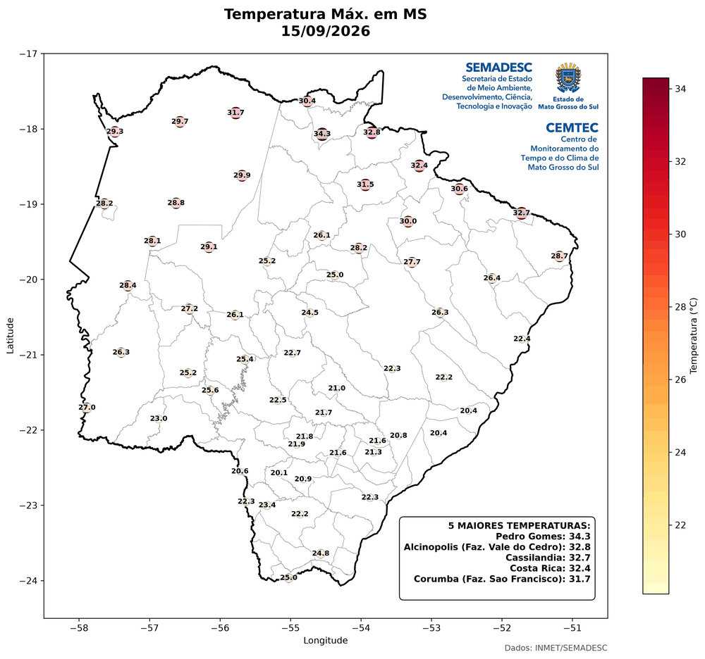 | 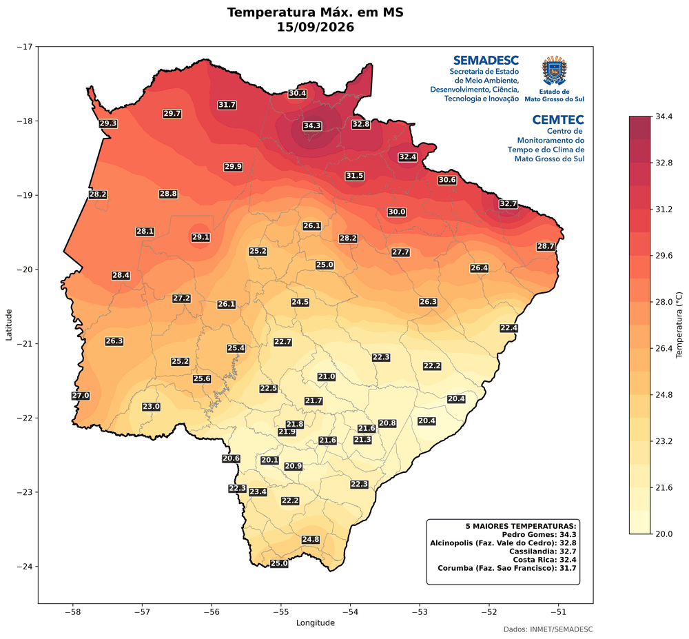 |

| Rajadas com direção (15/09/2026) | Chuva de 48 h — tempo real (até 25/11/2026) | Chuva do período (14 e 15/09/2026) |
|---|---|---|
| 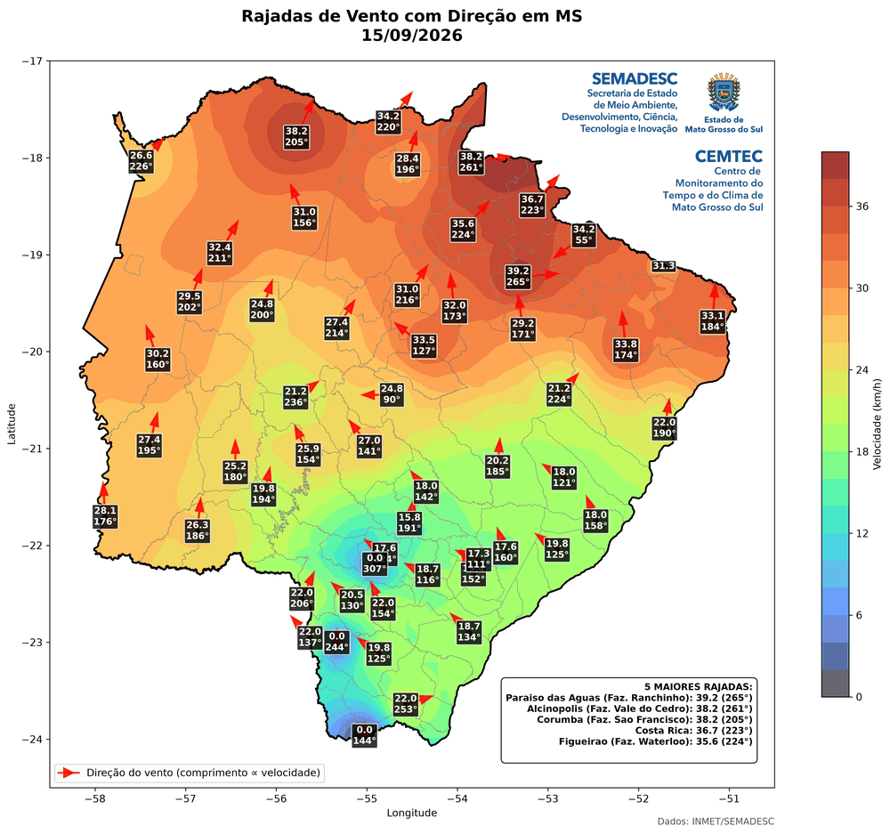 | 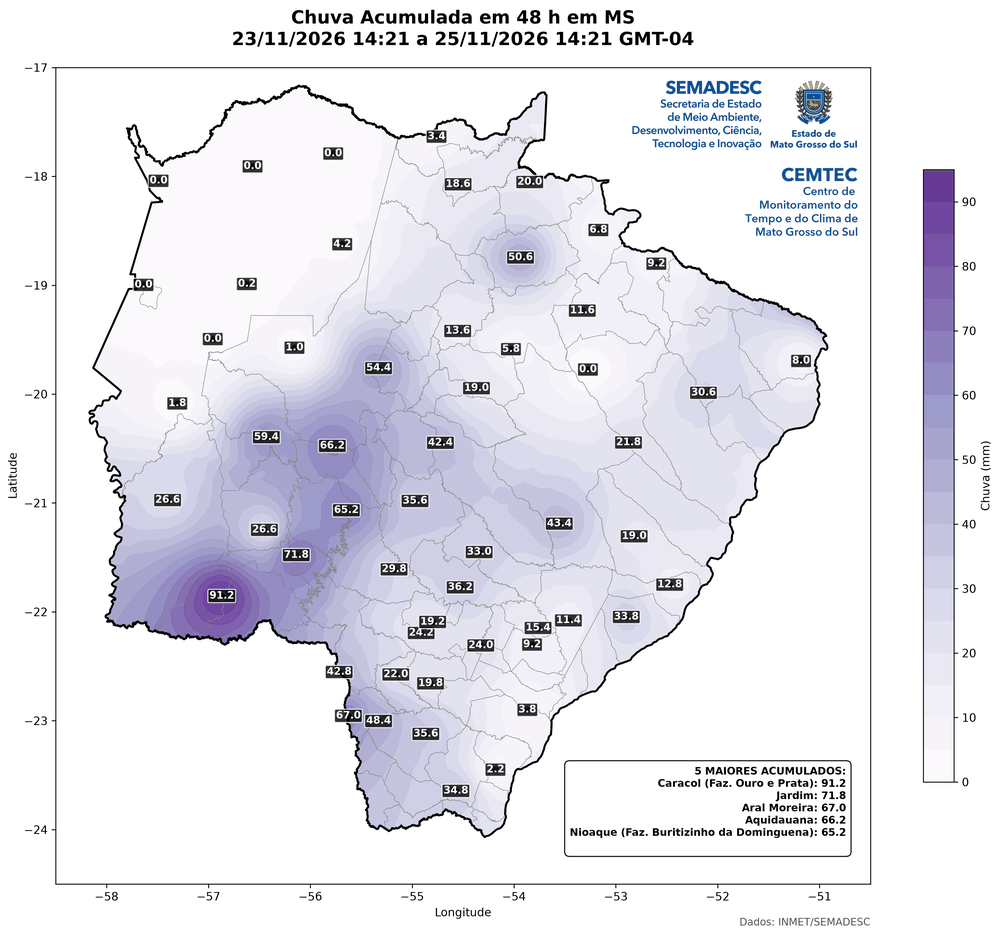 | 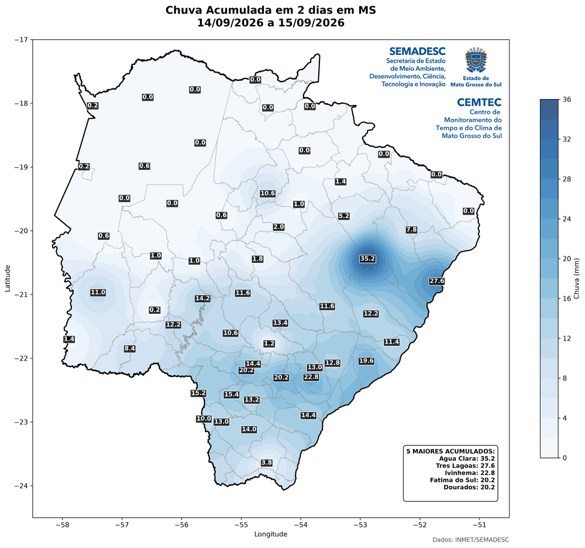 |

#### Dados de referência

- **API do INMET** (`apitempo.inmet.gov.br`)
  - `/estacoes/T` — lista de estações automáticas (sem token)
  - `/token/estacao/{data_ini}/{data_fim}/{codigo}/{token}` — dados horários de uma estação
  - Variáveis usadas: `TEM_MIN`, `TEM_MAX`, `UMD_MIN`, `VEN_RAJ`, `VEN_DIR` e `CHUVA`
- **Shapefiles**: `MS_UF_2022` (limite estadual, malha IBGE 2022) e `MS_mun_simplificado` (limites dos 79 municípios). Detalhes em [Estrutura do repositório](#shapefiles).

#### Notas metodológicas

- **Horários:** a API do INMET retorna os dados em UTC. Os dias, as janelas, os títulos e os nomes das pastas seguem o **horário do estado escolhido** — o fuso vem do recorte, e em MS é `America/Campo_Grande` (UTC−4). A planilha traz a data/hora das temperaturas em UTC e no horário local, e a **sigla do estado vai no nome da coluna** — `Data/Hora (MS)` em MS, `Data/Hora (SC)` em SC —, porque é ela que diz de que fuso se fala. No risco de fogo, o mesmo vale para as duas colunas de primeiro horário.
- **Leituras horárias:** cada leitura do INMET se refere à hora que termina no horário indicado (a das 05 UTC cobre das 04 às 05 UTC). Assim, em MS (UTC−4) o dia D — da 00 h às 24 h — reúne as leituras das 05 UTC do dia D às 04 UTC do dia seguinte; num estado UTC−3, uma hora antes.
- **Rajada:** `VEN_RAJ` é convertida de m/s para km/h (× 3,6). A direção registrada é a do horário da rajada máxima.
- **Interpolação:** IDW (inverso do quadrado da distância) com os 8 vizinhos mais próximos, em uma grade de 100 × 100 pontos sobre o **enquadramento do estado** — em MS, longitude −58,5 a −50,5 e latitude −24,5 a −17,0. Para as demais UFs o enquadramento sai do contorno mais 0,35° de folga, ignorando ilha oceânica distante (ver [Shapefiles](#shapefiles)). A distância é medida em quilômetros, numa projeção equidistante centrada na grade. São necessárias ao menos 3 estações. A superfície é calculada até um pouco além da divisa e recortada exatamente pelo contorno do estado. **As estações vizinhas entram na superfície** (desde 01/10/2026, nos dois produtos e em todos os estados): as de fora do estado que caem a até 1,5° do enquadramento e chegam às mais próximas de alguma célula — em MS são 39, de MT, GO, PR, SP e MG. Elas só entram na conta: planilha, ranking e mapa pontual continuam sendo do estado, e no risco de fogo o mapa horário continua saindo só quando uma estação **do estado** chega ao risco alto. A **escala de cores também é do estado**: a superfície fica presa na faixa que o estado faria sozinho, e a borda que passar dela leva a cor da ponta — sem isso, uma vizinha mais fria que todo MS esticava a régua e o mapa inteiro mudava de cor sem o miolo ter mudado. Se a lista das vizinhas falhar, o produto avisa e sai como antes, só com as do estado. Em MS, num dia comum, os mapas interpolados mudam de 1,5% a 4% dos pixels, todos na borda.
- **Mapas de chuva:** incluem as estações com 0 mm, que aparecem no mapa pontual e entram na interpolação. Num dia sem chuva em nenhuma estação, os mapas mostram 0 mm em todo o estado. A estação que **não mediu** chuva nenhuma na janela (só mandou bateria e processador, ou ficou sem transmitir) fica de fora da aba `Chuva` e dos mapas: sem medida não é 0 mm. A que mediu só algumas horas soma as que mediu.

#### Mudanças em relação aos scripts legados

Os três scripts de `legado/relatorio_inmet/` foram unificados neste produto. Diferenças nos resultados:

- **Período:** os extremos (temperaturas, umidade e rajada) agora ficam restritos ao período. Antes, o dia seguinte à data final também entrava no cálculo.
- **Data específica:** a aba `Chuva` traz apenas o `Acumulado Dia`. As colunas `Acumulado 24h` e `Acumulado 48h` foram removidas — a de 48 h somava só cerca de 24 h de dados.
- **Temperaturas:** sempre com data e hora completas, em UTC e em horário de MS.
- **Coordenadas:** `Latitude` e `Longitude` em todas as abas; a associação é feita pela própria estação, não pelo nome.
- **Mapa de rajadas com direção:** gerado em todos os modos (antes, só no tempo real).
- **Mapa de chuva de 72 h no tempo real:** novo (antes, só 24 h e 48 h).
- **Dia no horário de MS:** data específica e período usam o dia da 00 h às 24 h de MS (antes, o dia em UTC, com as leituras das 00 às 23 UTC).
- **Temperatura mínima no tempo real:** usa as últimas 24 horas, como as demais variáveis (antes, desde as 00 UTC do dia).
- **"Chuva Hoje" no tempo real:** conta desde a 00 h de MS (antes, desde as 00 UTC).
- **Estações com 0 mm nos mapas de chuva:** aparecem no mapa pontual e entram na interpolação (antes, eram descartadas).
- **Interpolação em quilômetros:** antes, a distância era medida em graus.
- **Horários nos títulos e nos nomes das pastas:** no horário de MS (antes, em UTC).
- **Logos:** em PNG com fundo transparente e posicionados em relação à moldura do mapa — mesmo lugar e proporção nos mapas pontuais e interpolados (antes, nos pontuais, um logo cobria o outro).
- **Bordas dos mapas interpolados:** a cor preenche o estado até a divisa. Antes, a superfície era cortada pela grade de cálculo (células de ~8 km) e deixava falhas em degrau junto às bordas.
- **Desempenho:** shapefiles, logos e máscara do estado são carregados uma única vez por execução, e os limites municipais usam uma versão simplificada (~5% dos vértices, sem diferença visível).

#### Decisões da equipe de meteorologia

Definidas pela equipe em **15/09/2026** (questões 1 a 5 de [`docs/questoes_meteorologia.md`](docs/questoes_meteorologia.md), com as perguntas, as opções e as respostas):

- O dia segue o horário de MS, da 00 h às 24 h.
- No tempo real, a temperatura mínima usa as últimas 24 horas, como as demais variáveis; a "Chuva Hoje" conta desde a 00 h de MS.
- As estações com 0 mm entram nos mapas de chuva, pontual e interpolado.
- As distâncias da interpolação são medidas em quilômetros; potência 2, 8 vizinhos e grade de ~8 km foram mantidos.
- Os extremos restritos ao período e o mapa de rajadas com direção em todos os modos foram confirmados; o acumulado de 48 h da data específica fica de fora por enquanto.
- Os scripts originais continuam em `legado/` até a equipe decidir pela exclusão.

---

### Produto `risco_fogo`

Risco meteorológico de fogo pela regra **30-30-30**. É um produto novo, pedido pela equipe de meteorologia, e não veio de script legado.

#### O que calcula

Conta, **em cada hora**, quantas das três condições da regra são atendidas:

| Condição | Limiar |
|---|---|
| Temperatura máxima | ≥ 30 °C |
| Umidade relativa mínima | ≤ 30 % |
| Rajada de vento | ≥ 30 km/h |

Cada condição atendida soma um nível:

| Nível | Condições atendidas | Classe | Cor |
|:---:|---|---|---|
| 0 | Nenhuma | Sem condição | Cinza |
| 1 | Uma | Risco baixo | Amarelo |
| 2 | Duas | Risco médio | Laranja |
| 3 | As três | Risco alto | Vermelho |

**Por que hora a hora?** Os extremos de um dia acontecem em horários diferentes. Uma estação pode ter 32 °C às 15 h, 28 % de umidade às 18 h e rajada de 35 km/h às 03 h — contando os extremos do dia, seria "risco alto", mas calor, seca e vento nunca estiveram juntos. Avaliando cada hora, só é risco alto se as três condições acontecerem na mesma hora.

Passo a passo de uma execução:

1. Consulta as estações automáticas do estado e baixa a série horária da janela.
2. Em cada estação e em cada hora, conta quantas condições foram atendidas.
3. Gera a planilha com o resumo de cada estação: nível máximo, quantas horas em cada nível e os valores que dispararam as condições.
4. Em cada hora, interpola **separadamente** as três variáveis sobre o estado e aplica a regra em cada ponto do mapa.
5. Gera os mapas de síntese (nível máximo e horas em risco alto) e um mapa por hora.

#### Como rodar

```bash
python main.py --produto risco_fogo --tempo-real                          # últimas 24 horas
python main.py --produto risco_fogo --dataini 03/09/2026                   # um dia
python main.py --produto risco_fogo --dataini 03/09/2026 --hrini 12 --hrfim 18  # trecho de um dia
python main.py --produto risco_fogo --dataini 03/09/2026 --hrtodas         # um dia, com o mapa de todas as horas
```

#### Tempo real, data específica e período

| | Tempo real | Data específica |
|---|---|---|
| **Janela** | As últimas 24 horas cheias até o momento em que roda | O dia, da 00 h às 24 h do estado — ou o trecho entre `--hrini` e `--hrfim` |
| **Exemplo** | Rodando às 16h10 de 16/09: das 16 h de 15/09 às 16 h de 16/09 | `--dataini 03/09/2026`: da 00 h às 24 h de 03/09 |
| **Pasta** | `tempo_real/20260916_1610/` | `dia/20260903/` |

**No período** (datas diferentes, ou horas que atravessam dois dias) tudo funciona igual, somando os dias: o mapa de nível máximo mostra o pior nível que cada lugar alcançou em todo o período, e o de horas agregadas soma as horas em risco alto de todos os dias. A planilha ganha duas colunas — `Dias com Risco Alto` e `Dias com Risco Médio` —, porque num período "5 dias em risco alto" diz mais do que "20 horas no total".

O período é também o único modo que gera **gráficos**, porque eles comparam dias entre si: as horas de cada estação em cada nível, um calendário de estação × dia e, para cada dia, as horas em que cada condição foi atendida. Num dia sozinho não haveria o que comparar.

> **Atenção ao volume:** os mapas horários continuam saindo em todas as horas com risco alto, e quanto maior o período, mais arquivos e mais tempo de execução. Como referência, 01 a 03/09/2026 rendeu 9 mapas horários, 15 MB e 15 segundos — mas só o dia 03/09, sozinho, rendeu 7 deles. Num mês de seca, espere algumas dezenas de mapas.

#### Saídas

```
saida/risco_fogo/dia/20260903/
├── Risco_Fogo_MS_20260903.xlsx
└── mapas/
    ├── Mapa_Risco_Fogo_Nivel_MS_20260903.png
    ├── Mapa_Risco_Fogo_Nivel_MS_20260903_interpolado.png
    ├── Mapa_Risco_Fogo_Horas_MS_20260903.png
    ├── Mapa_Risco_Fogo_Horas_MS_20260903_interpolado.png
    └── horas/
        ├── Mapa_Risco_Fogo_MS_20260903_10h.png
        ├── Mapa_Risco_Fogo_MS_20260903_11h.png
        └── ...
```

| Arquivo | O que é |
|---|---|
| `Risco_Fogo_MS_<datas>.xlsx` | Planilha (aba `Risco`) com uma linha por estação, da de maior risco para a de menor |
| `Mapa_Risco_Fogo_Nivel_MS_<datas>.png` | **Nível máximo — pontual:** o pior nível que cada estação alcançou em alguma hora da janela |
| `Mapa_Risco_Fogo_Nivel_MS_<datas>_interpolado.png` | **Nível máximo — interpolado:** o mesmo, sobre o estado inteiro |
| `Mapa_Risco_Fogo_Horas_MS_<datas>.png` | **Horas em risco alto — pontual:** quantas horas cada estação passou no nível 3 |
| `Mapa_Risco_Fogo_Horas_MS_<datas>_interpolado.png` | **Horas em risco alto — interpolado:** o mesmo, sobre o estado inteiro |
| `horas/Mapa_Risco_Fogo_MS_<data>_<hora>h.png` | **Mapa horário** (só interpolado): o nível de risco naquela hora, com o nível de cada estação e os pontos das condições que ela atendeu |
| `Grafico_Risco_Fogo_Niveis_MS_<datas>.png` | **Só no período.** Horas que cada estação passou em cada nível, com o total ao lado da barra. Cada barra vai do risco alto para o baixo: a estação que chegou ao alto mostra o vermelho primeiro |
| `Grafico_Risco_Fogo_Calendario_MS_<datas>.png` | **Só no período.** Um quadrado por dia de cada estação, na cor do pior nível daquele dia. **Em branco** fica o dia sem nenhuma hora com as três medidas (estação sem transmitir, ou um sensor sem dado), que a legenda chama de "Sem dado"; **cinza** é o dia medido em que nenhuma condição valeu |
| `graficosDeCondicoes/Grafico_Risco_Fogo_Condicoes_MS_<data>.png` | **Só no período.** Um arquivo por dia: horas em que cada estação atendeu cada condição |

O **nível máximo** mostra o pico; as **horas em risco alto** mostram a duração — ficar 6 horas em 30-30-30 é bem diferente de ficar 1 hora. Em dias em que nenhuma estação chega ao nível 3, os mapas de horas ficam zerados.

**Quais horas ganham mapa próprio:** por padrão, só as horas em que **pelo menos uma estação** chegou ao risco alto (nível 3); num dia sem risco alto, a pasta `horas/` nem é criada. Com `--hrtodas`, saem todas as horas, até 24 num dia. Cada mapa horário leva a hora em que a leitura termina: o das 14h mostra a hora das 13 h às 14 h.

**Pontos das condições nos mapas horários:** o número de cada estação é o nível dela **naquela hora**, e abaixo dele aparece um ponto para cada condição atendida — roxo para temperatura, azul para umidade e verde para rajada. Cada condição ocupa sempre a mesma posição (temperatura à esquerda, umidade no meio, rajada à direita), então dá para identificá-la mesmo sem distinguir as cores. Os mapas de síntese não têm os pontos: eles juntam horas diferentes, e as condições de uma única hora não representariam o dia.

Colunas da planilha:

| Coluna | O que é |
|---|---|
| `Nível Máximo` | Pior nível alcançado na janela (0 a 3) |
| `Horas em Risco Alto`, `Horas Nível 2`, `Horas Nível 1` | Quantas horas a estação passou em cada nível |
| `Horas com Dados` | Quantas horas tinham as três variáveis |
| `Dias com Risco Alto`, `Dias com Risco Médio` | Só no período: em quantos dias o pior nível da estação foi o alto e em quantos foi o médio |
| `Temp. Máxima (°C)`, `Umidade Mínima (%)`, `Rajada Máxima (km/h)` | Extremos da janela, para conferir por que a estação recebeu o seu nível |
| `Primeiro Horário em Risco Médio (MS)` | Quando a estação chegou ao nível 2 pela primeira vez — mostra quando o risco começou a subir, mesmo nos dias que não chegam ao nível 3 |
| `Primeiro Horário em Risco Alto (MS)` | Quando a estação chegou ao nível 3 pela primeira vez (vazio se não chegou) |
| `Latitude`, `Longitude` | Posição da estação |

#### Exemplos

Mapas gerados com dados reais do INMET para **03/09/2026**.

| Nível máximo — pontual | Nível máximo — interpolado | Horas em risco alto — interpolado |
|---|---|---|
| 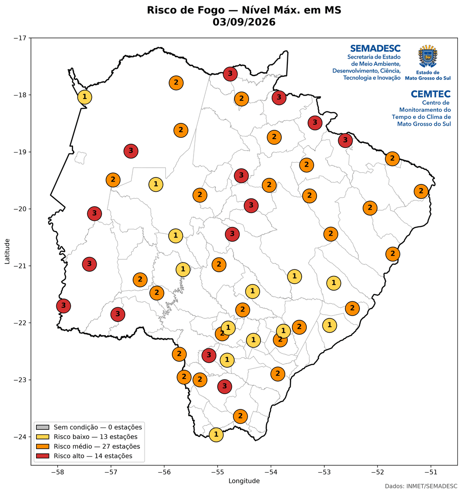 | 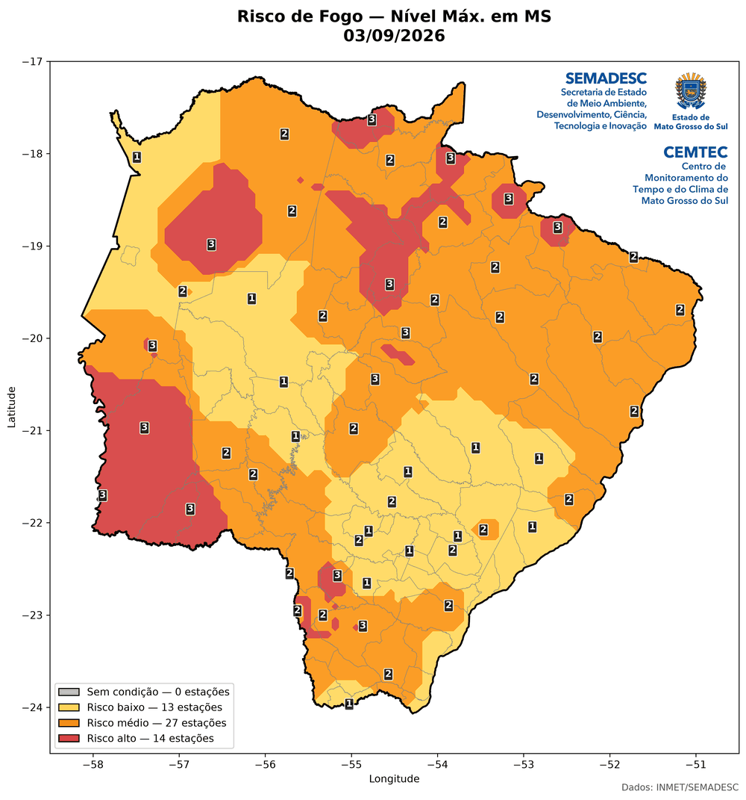 | 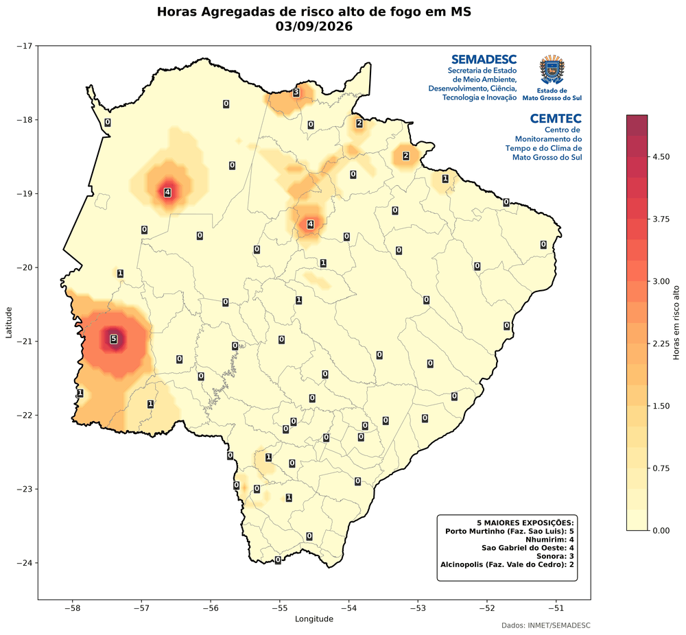 |

Os gráficos do período, na semana de 01 a 07/09/2026. O calendário mostra o episódio: 02 a 04/09 formam um bloco de risco alto, e a semana acalma depois.

| Horas em cada nível | Calendário estação × dia | Condições de um dia |
|---|---|---|
| 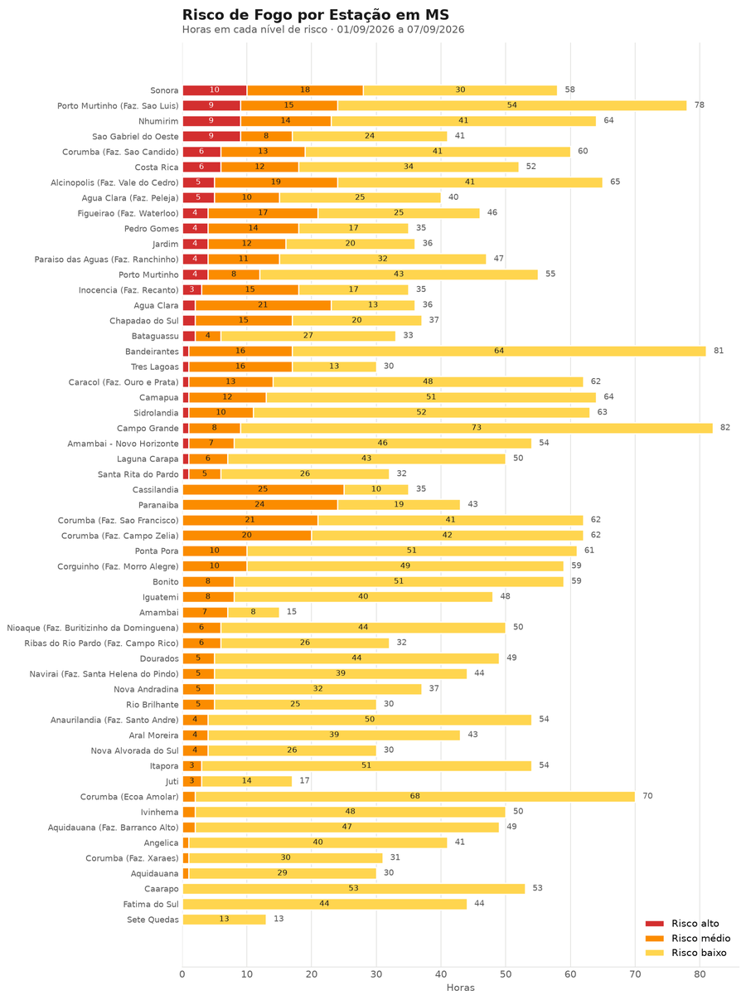 | 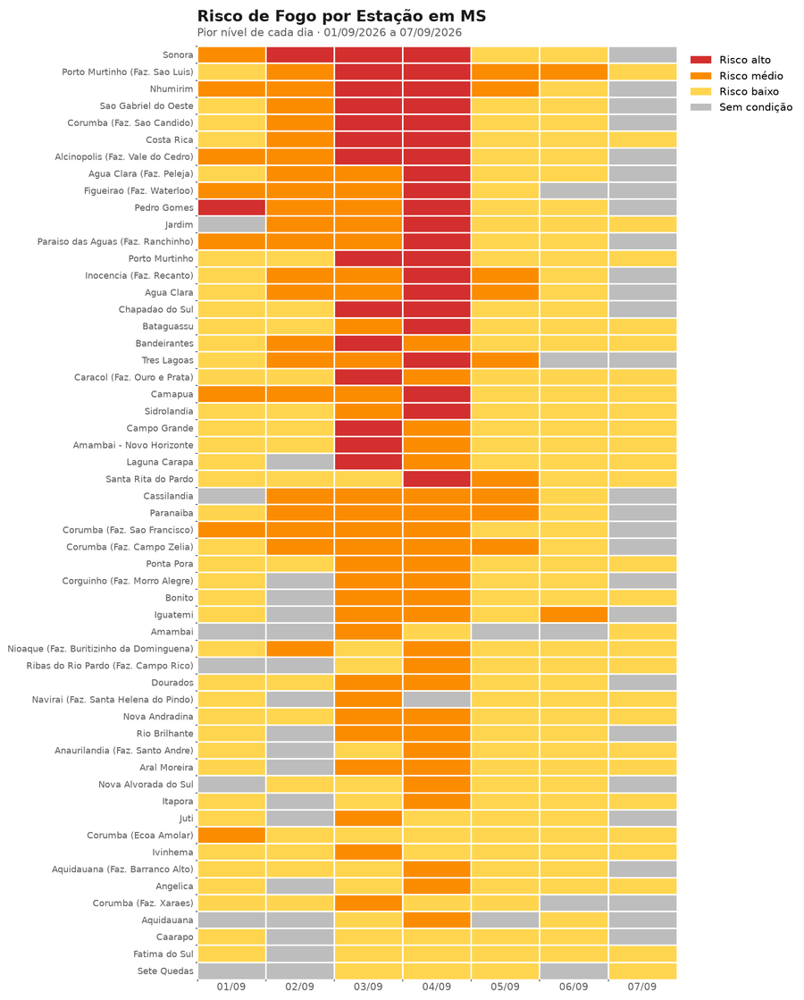 | 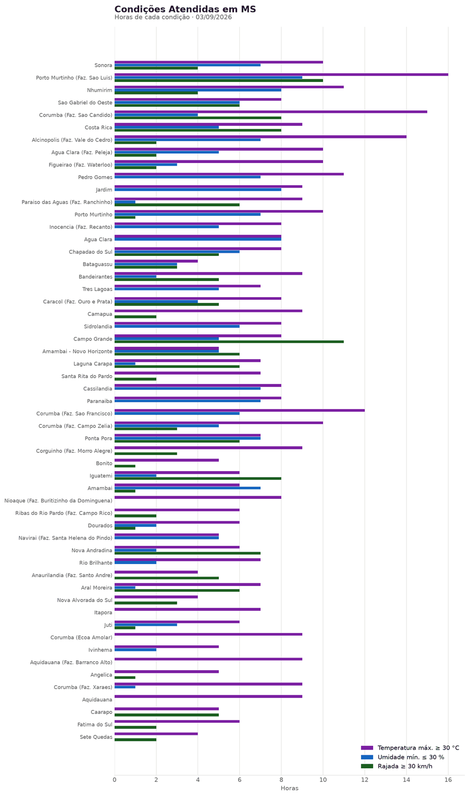 |

A evolução ao longo do dia, nos mapas horários. Em 03/09 o risco alto apareceu às 10h, se espalhou à tarde e desapareceu depois das 16h — por isso o dia rendeu sete mapas horários:

| 10h | 13h | 16h |
|---|---|---|
| 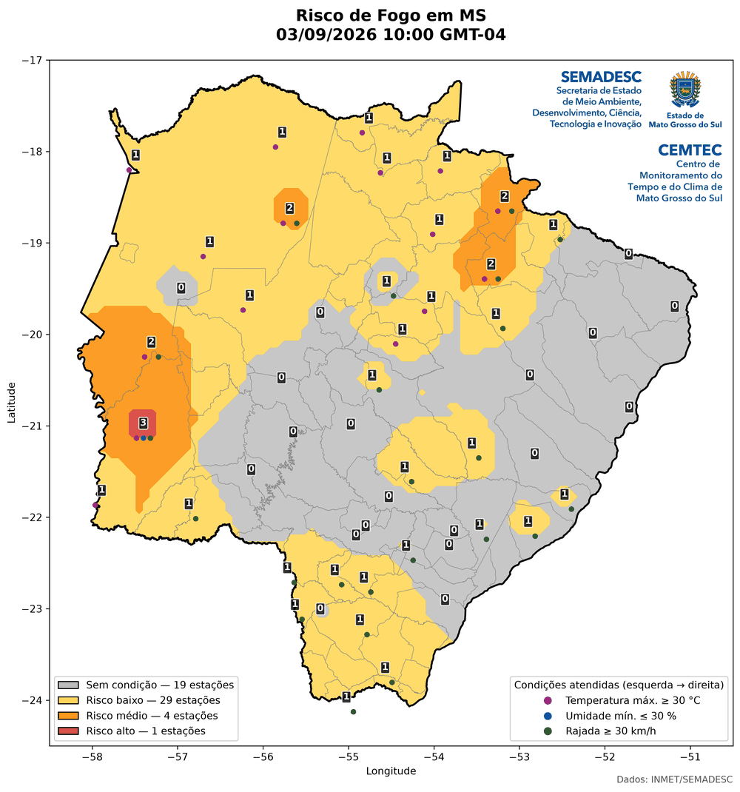 | 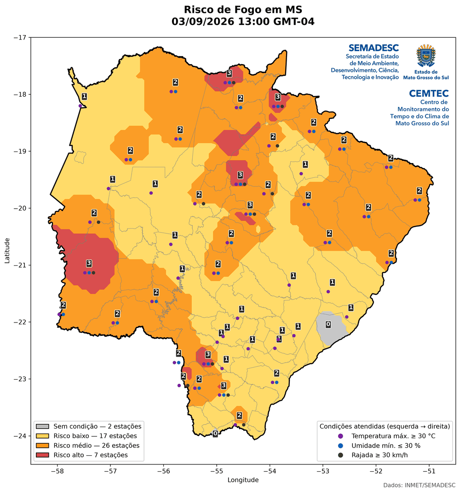 | 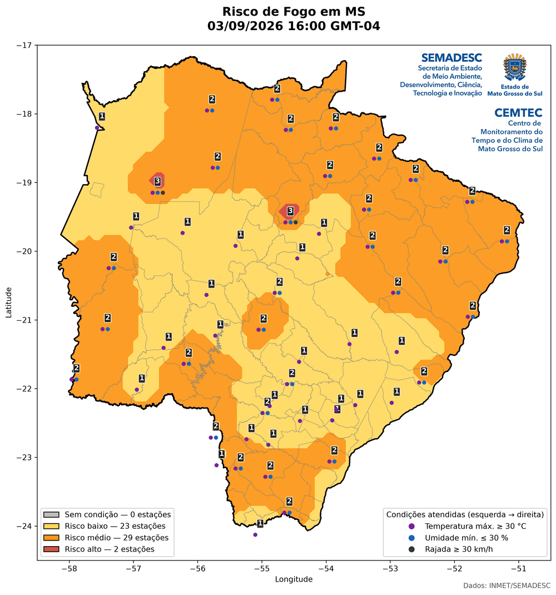 |

#### Dados de referência

- **API do INMET** (`apitempo.inmet.gov.br`)
  - `/estacoes/T` — lista de estações automáticas (sem token)
  - `/token/estacao/{data_ini}/{data_fim}/{codigo}/{token}` — dados horários de uma estação
  - Variáveis usadas: `TEM_MAX`, `UMD_MIN` e `VEN_RAJ`
- **Limiares, cores e rótulos** ficam em [`modulos/config.py`](modulos/config.py): `LIMIAR_TEMP_MAX`, `LIMIAR_UMIDADE_MIN`, `LIMIAR_RAJADA`, `CORES_RISCO`, `ROTULOS_RISCO`, `NIVEL_MAPA_HORARIO` e `CORES_CONDICOES` (cores dos pontos das condições).
- **Shapefiles**: `MS_UF_2022` (limite estadual, malha IBGE 2022) e `MS_mun_simplificado` (limites dos 79 municípios). Detalhes em [Estrutura do repositório](#shapefiles).

#### Notas metodológicas

- **Horários e leituras:** como no `relatorio_inmet`, os dados chegam em UTC e são exibidos no horário do estado, e cada leitura se refere à hora que termina no horário indicado.
- **Limiares inclusivos:** exatamente 30 °C, 30 % ou 30 km/h já contam como condição atendida.
- **Rajada:** `VEN_RAJ` vem em m/s e é convertida para km/h (× 3,6) antes da comparação — 30 km/h equivalem a 8,33 m/s.
- **Simultaneidade:** a regra é testada dentro de cada leitura horária, que traz a temperatura máxima, a umidade mínima e a rajada daquela hora. Dentro de uma mesma hora, os três valores podem estar separados por alguns minutos: é a resolução mais fina que a API oferece.
- **Interpolação:** mesmo IDW do `relatorio_inmet` (8 vizinhos, distância em km, grade de 100 × 100), aplicado **a cada hora e a cada variável separadamente**; a regra 30-30-30 é aplicada depois, ponto a ponto. Interpolar o nível 0–3 diretamente produziria valores sem sentido físico ("1,7 condições") e espalharia risco médio onde nenhuma estação o registrou. Horas com menos de 3 estações não são interpoladas.
- **Mapas de síntese interpolados:** saem da pilha de mapas horários — o nível máximo é o maior nível de cada ponto ao longo das horas, e as horas em risco alto são quantas vezes cada ponto chegou ao nível 3.
- **Pontual e interpolado podem discordar**, e isso não é erro: a superfície pode mostrar nível 2 num lugar onde nenhuma estação chegou a 2, porque ela vem das variáveis interpoladas, e não dos níveis das estações.
- **Rajada é a variável menos confiável do mapa interpolado:** vento de rajada é muito local, então a superfície de vento é mais incerta que as de temperatura e umidade.
- **Estações incompletas:** estações a que falte temperatura, umidade ou rajada ficam de fora e são listadas ao rodar — incluí-las subestimaria o risco, já que nunca poderiam alcançar o nível 3.

#### Mudanças em relação aos scripts legados

Não se aplica: o `risco_fogo` é um produto novo, desenvolvido a partir do pedido da equipe de meteorologia, sem script legado de origem.

#### Decisões da equipe de meteorologia

O método foi definido em **16/09/2026** a partir do pedido da equipe (questões 6 a 8 de [`docs/questoes_meteorologia.md`](docs/questoes_meteorologia.md)):

- Regra avaliada hora a hora, e não sobre os extremos do período.
- Três variáveis interpoladas separadamente, com a regra aplicada ponto a ponto.
- Somente data específica e tempo real; período fica para os gráficos de uma etapa futura.
- Mapas de síntese (nível máximo e horas em risco alto) em versão pontual e interpolada, sempre gerados; mapas horários só interpolados, apenas nas horas com alguma estação em risco alto, ou todos com `--hrtodas`.
- A planilha conta as horas nos três níveis e traz o primeiro horário em risco médio e em risco alto: dá para acompanhar quando o risco começou a subir, mesmo nos dias que não chegam ao nível 3.
- As três condições têm o mesmo peso; estações sem uma das variáveis ficam de fora.
- Cores cinza, amarelo, laranja e vermelho (sem o par verde/vermelho, por causa do daltonismo).
- Nos mapas horários, pontos das condições atendidas abaixo de cada estação, em posição fixa (definido em 17/09/2026).
- No período, três gráficos: horas por nível, calendário de estação × dia e as condições de cada dia (definido em 21/09/2026).

Em **17/09/2026** a equipe confirmou duas aproximações do método: avaliar a simultaneidade dentro de cada hora (a janela mais fina que a API oferece) e manter a rajada na superfície interpolada, apesar de o vento ser muito local.

⚠️ **Ainda aguardam confirmação da meteorologia:** os limiares (≥ 30 °C, ≤ 30 %, ≥ 30 km/h) e o critério de gerar mapa horário só a partir do risco alto.

---

## Requisitos

- Python **3.14 ou superior** — a versão que a equipe usa e a única que a CI testa
- Token de acesso à API do INMET
- Conexão com a internet

Principais bibliotecas (lista completa em [`requirements.txt`](requirements.txt)):

| Biblioteca | Uso |
|---|---|
| `pandas` | Tabelas, datas e exportação para Excel |
| `requests` | Chamadas à API do INMET |
| `numpy` / `scipy` | Grade e interpolação IDW (`cKDTree`) |
| `geopandas` / `shapely` | Leitura dos shapefiles e recorte espacial |
| `matplotlib` | Geração dos mapas |
| `openpyxl` | Escrita e formatação da planilha Excel |
| `tzdata` | Fusos horários (obrigatório no Windows) |
| `python-dotenv` | Leitura do arquivo `.env` |
| `psycopg` | O banco da UNIGEO (PostgreSQL), para os coletores, a fonte "banco" e os testes do banco |

## Instalação

**Windows (PowerShell):**

```powershell
python -m venv .venv
.venv\Scripts\Activate.ps1
pip install -r requirements.txt
```

**Linux / macOS:**

```bash
python3 -m venv .venv
source .venv/bin/activate
pip install -r requirements.txt
```

## Como atualizar

Quem usa os scripts trabalha com uma cópia local do repositório, feita uma única vez com `git clone`. Quando sair uma versão nova, essa cópia não se atualiza sozinha: é preciso pedir.

Abra o terminal **dentro da pasta do projeto** e rode:

```bash
git pull
```

Pronto — os arquivos passam a ser os da versão nova. A pasta `saida/`, com os seus resultados, e o arquivo `.env`, com o token, não são tocados: os dois ficam fora do controle de versão.

Para ver em que versão você está:

```bash
git describe --tags
```

A resposta `0.2.2` quer dizer exatamente a versão 0.2.2. Algo como `0.2.2-3-g1a2b3c4` quer dizer três commits depois dela, ainda sem versão nova fechada. O que mudou em cada uma está no [CHANGELOG.md](CHANGELOG.md).

A versão fechada é uma tag **sem** o `v` (`0.2.2`). O nome com `v` (`v0.2.3`) é a branch onde a versão está sendo feita: se os dois tivessem o mesmo nome, o git não saberia qual dos dois você quer dizer.

### Se o `git pull` reclamar de alterações locais

Se aparecer algo como *"Your local changes to the following files would be overwritten by merge: main.py"*, significa que o arquivo foi editado na sua máquina — normalmente para trocar o produto ou as datas no topo do `main.py`. O git não sobrescreve isso sem a sua autorização.

Para descartar a sua edição e ficar com a versão nova:

```bash
git checkout -- main.py
```

Depois, repita o `git pull`.

Para não passar por isso toda vez, prefira informar produto e datas **pela linha de comando**, em vez de editar o arquivo. Assim o `main.py` nunca muda na sua máquina:

```bash
python main.py --produto risco_fogo --dataini 20/09/2026
```

### Depois de atualizar

Se a atualização mexeu no `requirements.txt`, instale o que faltar, com o ambiente virtual ativo:

```bash
pip install -r requirements.txt
```

O que mudou em cada versão está no [CHANGELOG.md](CHANGELOG.md). Comece pelo grupo **Atenção ao atualizar** da versão nova: é ali que fica o que pode quebrar um comando anotado ou mudar um resultado já conhecido. Vale também conferir a seção [Como usar](#como-usar), que descreve as opções como elas estão hoje.

## Configuração

### Token do INMET

O token é lido do arquivo `.env`, na raiz do projeto:

1. Crie o `.env` a partir do modelo:

   ```powershell
   Copy-Item .env.example .env
   ```

   No Linux/macOS: `cp .env.example .env`.

2. Abra o `.env` e preencha `TOKEN_INMET` com o token da equipe:

   ```
   TOKEN_INMET=seu_token_aqui
   ```

Sem o token configurado, o `main.py` para com uma mensagem de erro antes de chamar a API.

> O `.env` contém credenciais e **nunca deve ser commitado** — ele já está no `.gitignore`. Em agendamentos ou servidores, o token também pode ser definido como variável de ambiente `TOKEN_INMET`, que tem prioridade sobre o `.env`.

### Conta da PED do CEMADEN (só no servidor)

O coletor dos pluviômetros do CEMADEN (`python coletar.py cemaden`) entra na PED, a plataforma de dados do CEMADEN, com a conta da equipe. Ela vai no `.env` só da máquina do coletor, a mesma conta do login no site [ped.cemaden.gov.br](https://ped.cemaden.gov.br):

```
CEMADEN_EMAIL=email_da_conta
CEMADEN_SENHA=senha_da_conta
```

A PED aceita **12 consultas por minuto por conta**, e o coletor faz no máximo 10, uma a cada 6 segundos. O painel e o `main.py` não consultam a PED: o painel do servidor lê os pluviômetros do banco.

### De onde vêm os dados (`FONTE_DADOS`) e o banco

O painel e os produtos pedem as estações, as leituras e a previsão ao [`modulos/fonte.py`](modulos/fonte.py), que busca onde a configuração mandar:

| `FONTE_DADOS` | De onde | Quem usa |
|---|---|---|
| `apis` (o padrão) | Direto da API do INMET e do Open-Meteo, na hora | Quem roda o `main.py` ou o painel na própria máquina, sem acesso ao banco |
| `banco` | Do banco da UNIGEO (schema `climageo`), que os coletores alimentam | O painel do servidor |

As contas, os mapas e as planilhas saem iguais nas duas. O que muda:

- **Só o banco tem** os pluviômetros do CEMADEN e os raios do GOES. Com `apis`, a página Raios não aparece e os mapas de chuva ficam só com o INMET.
- **A grade da previsão** é de 0,25° no banco (a do coletor) e de 0,5° na busca direta.

As conexões do banco vão no `.env`, entre aspas, no formato de palavras-chave do PostgreSQL. Cada máquina põe só as que usa:

```
FONTE_DADOS=banco
BANCO_LEITURA="host=servidor port=5432 dbname=banco user=usuario_que_le password=senha"
BANCO_GRAVACAO="host=servidor port=5432 dbname=banco user=usuario_que_grava password=senha"
```

| Conexão | Quem usa |
|---|---|
| `BANCO_LEITURA` | O painel do servidor, com o usuário que só lê |
| `BANCO_GRAVACAO` | Os coletores |
| `BANCO_TESTE` | Os testes do banco, na máquina de quem programa (veja [Testes](#testes)) |

O modelo de tudo está no [`.env.example`](.env.example).

### Logos

Os logos ficam em `img/`, em **PNG com fundo transparente** — uma imagem com fundo branco cobriria o mapa. A posição e o tamanho de cada um são definidos na lista `LOGOS`, em [`modulos/config.py`](modulos/config.py), como um retângulo `[x, y, largura, altura]` em fração da moldura do mapa: `(0, 0)` é o canto inferior esquerdo e `(1, 1)` o superior direito. O logo se ajusta ao retângulo mantendo a proporção e fica alinhado ao canto superior direito dele, no mesmo lugar em todos os mapas.

### Demais parâmetros

Ficam em [`modulos/config.py`](modulos/config.py): pastas, endereços, tempos limite e tentativas da API, resolução dos mapas, posição dos logos, parâmetros da interpolação e limiares do risco de fogo.

**O estado não é uma constante: é um `Recorte`.** A dataclass reúne o que faz um estado ser ele mesmo — sigla, nome, os dois shapefiles, o enquadramento e o **fuso** — e é ela que viaja nas chamadas (`carregar_base(recorte)`, `estacoes_do_recorte(recorte)`, `Periodo.de_datas(..., fuso=)`). Quem não passa nada recebe o padrão, que é MS, e nada muda. Não é uma variável global que se troca: o painel serve várias pessoas no mesmo processo, e a escolha de uma não pode mudar o mapa que a outra está olhando. O fuso está dentro do recorte porque é ele que decide onde o dia começa — MS (GMT-04) e Paraná (GMT-03) partem o mesmo dia em horas diferentes.

### Quando a API do INMET falha

É comum a API encerrar a conexão sem responder no meio de uma consulta. Nesse caso, a estação é consultada de novo até `TENTATIVAS` vezes (padrão: 3), dobrando a espera a cada tentativa. Se ainda assim não der certo, a execução continua com as demais estações e o resumo do fim separa as que ficaram de fora:

- **Sem leituras no período** — a estação respondeu, mas não tem dados nessas horas.
- **Falha na consulta** — não foi possível ler a estação. Ela pode ter dados: vale repetir a consulta mais tarde.

Erros de token (HTTP 4xx) não são repetidos, porque novas tentativas não resolvem.

**O INMET aceita 100 consultas por minuto de cada endereço de rede**, contando todas as que saem dele: as de quem está na mesma rede e as do coletor do banco, quando ele rodar no servidor da unidade. Uma consulta de MS com as estações vizinhas faz umas 100. Passado o limite, o INMET recusa até o minuto virar, e a consulta espera, sem contar como falha: quem roda o `main.py` logo depois de outra pessoa pode ver a coleta parar por até um minuto antes de seguir. Até a 0.3.1, a recusa contava como falha, e a estação ficava de fora.

## Testes

Os testes usam uma API do INMET simulada, então não precisam de token nem de internet:

```bash
pip install -r requirements-dev.txt
pytest
```

Rode os testes antes de cada commit: eles conferem as janelas de tempo, os cálculos, o acesso à API e a execução completa (Excel e mapas) de cada produto.

Os testes do banco (`tests/test_banco.py` e parte dos do coletor do INMET e dos raios) precisam de um PostgreSQL de verdade. Eles usam a conexão `BANCO_TESTE` do `.env` e trabalham no schema `climageo_teste`, que apagam e recriam a cada execução. Sem essa linha no `.env`, eles são pulados.

Os testes também rodam automaticamente no GitHub (GitHub Actions, em Linux, com Python 3.14) a cada push e a cada pull request para a `main`. Ali, os do banco rodam num PostgreSQL 16 com PostGIS que sobe vazio, só para eles. O resultado aparece como ✓ ou ✗ ao lado de cada commit e na aba **Actions** do repositório, onde também é possível rodá-los manualmente.

## Banco e coletores (servidor)

No servidor da unidade, os coletores guardam os dados no banco da UNIGEO (PostgreSQL 16, schema `climageo`), e o painel do servidor lê dali (`FONTE_DADOS=banco`, veja [De onde vêm os dados](#de-onde-vêm-os-dados-fonte_dados-e-o-banco)). Tudo pela linha de comando do [`coletar.py`](coletar.py), na raiz do projeto:

| Comando | O que faz | Quando |
|---|---|---|
| `python coletar.py esquema` | Cria as tabelas que faltam ([`banco/esquema.sql`](banco/esquema.sql)). Pode rodar de novo | Na instalação e quando uma versão traz tabela nova |
| `python coletar.py inmet` | As leituras horárias de todas as estações automáticas do Brasil: rebusca os últimos 3 dias, com uma consulta por hora, e o banco só reescreve o que o INMET mudou | De hora em hora, aos 50 minutos |
| `python coletar.py inmet --extras` | A sensação térmica, a bateria e a temperatura do processador, por estação, que a consulta por hora não traz | Uma vez por dia |
| `python coletar.py inmet --revisar 30` | Rebusca os últimos 30 dias, para o banco receber o que o INMET corrigiu depois | Uma vez por semana |
| `python coletar.py inmet --historico 2018-01-01` | A carga do histórico. Pode ser interrompida com Ctrl+C e retomada com o mesmo comando | Uma vez só |
| `python coletar.py previsao` | As rodadas das 00Z e das 12Z do ECMWF, do GFS e do ICON (grade de 0,25° e pontos das estações) e o EC46. A conferência que não acha rodada nova não gasta cota | De hora em hora |
| `python coletar.py cemaden` | O cadastro e a chuva dos pluviômetros do CEMADEN em MS, dos últimos 3 dias (veja [Conta da PED do CEMADEN](#conta-da-ped-do-cemaden-só-no-servidor)) | De hora em hora, aos 5 minutos |
| `python coletar.py cemaden --historico 2015-03-01` | A carga do histórico do CEMADEN, em umas 8 horas, retomável | Uma vez só |
| `python coletar.py raios` | Conta os flashes do GLM (GOES-19) do estado por hora e por célula de 0,1°, a partir das tabelas que o script de um colega grava no mesmo banco. A primeira execução conta o que já está lá e leva uns 20 minutos | De 10 em 10 minutos |

**A trava da gravação dos raios.** O script do colega grava o disco inteiro do GOES-19 na tabela dele (`relampagos_glm_rt`), uns 7 GB por dia com a carga do histórico. Até a tabela ser recortada a 2.500 km de Campo Grande, o [`ferramentas/trava_glm.py`](ferramentas/trava_glm.py) liga e desliga um gatilho que recusa essa gravação, sem renomear a tabela: o painel e o `coletar.py raios` continuam lendo. Roda com a conexão de gravação:

```bash
python ferramentas/trava_glm.py estado     # a trava, o tamanho da tabela e se ainda entra flash
python ferramentas/trava_glm.py parar      # liga a trava
python ferramentas/trava_glm.py retomar    # desliga a trava (o gatilho fica, desligado)
```

Com `--teste`, qualquer um deles grava no `climageo_teste`, com a conexão `BANCO_TESTE`, e não no banco de verdade. O coletor sai com código 1 quando o banco ou alguma consulta falham, para o Agendador marcar a falha.

**No Windows, quem chama os coletores é o Agendador de Tarefas.** O [`servidor\criar_tarefas.ps1`](servidor/criar_tarefas.ps1) cria (ou recria) as seis tarefas, com os horários da tabela acima. Elas rodam com o usuário conectado ou não, por isso o script pede a senha do Windows, que vai direto para o Agendador:

```powershell
powershell -ExecutionPolicy Bypass -File servidor\criar_tarefas.ps1
```

Cada tarefa chama o [`servidor\coletar.bat`](servidor/coletar.bat), que grava a saída em `logs\coletor_<trabalho>.log`. As tarefas rodam o código da pasta onde o script rodou, na branch que estiver nela. O painel do servidor sobe pelo [`servidor\iniciar_painel.bat`](servidor/iniciar_painel.bat), com a saída em `logs\painel.log`. Depois de uma atualização, ele só muda quando é reiniciado.

O desenho completo (as tabelas, os usuários do banco, o que falta para o servidor definitivo) está em [`docs/plano_arquitetura.md`](docs/plano_arquitetura.md).

## Explorador (Streamlit)

Ferramenta de **análise**, separada dos produtos: olha-se o dado para entender tendências e conferir a qualidade da medição, sem gerar os arquivos do relatório. Os produtos continuam saindo pelo `main.py`, e o explorador não altera nada do que eles produzem.

> **Esta seção descreve o painel da `main` (0.4.1 em diante)**, o da equipe na rede da unidade, que lê do banco. O painel publicado no **Streamlit Cloud** é outra linha: a **0.3.9**, da branch `streamlit`, que só lê das APIs e tem as abas antigas (Mapas Boletim, Chuva, Risco de Fogo, Mapa Navegação, Qualidade dos dados). Ele está descrito no README daquela branch.

Instale as dependências dele uma vez (quem só gera os produtos não precisa disto):

```bash
pip install -r app/requirements.txt
```

Os mapas do boletim usam o mesmo `modulos/mapas.py` dos produtos, então a lista inclui as bibliotecas de geoprocessamento (geopandas, shapely, pyogrio, pyproj e scipy). São ~165 MB — o preço de não manter um segundo desenho de mapa, que com o tempo divergiria do relatório.

E abra:

```bash
streamlit run app/explorador.py
```

O navegador abre em `http://localhost:8501`, na página **Observado › Mapas**. O menu, no topo da barra lateral, tem uma página por assunto, em três grupos:

| Grupo | Páginas |
|---|---|
| **Observado** | [Mapas](#observado--mapas) (com a localização das estações, as séries e a qualidade dos dados), [Chuva](#observado--chuva), [Risco de Fogo](#observado--risco-de-fogo) e, só no painel que lê do banco, [Raios](#observado--raios-goes-19) |
| **Previsão (MS)** | [Mapas, Chuva, Risco de Fogo e Semanas](#previsão-ms) |
| **CICOE (em desenvolvimento)** | [Mapa de camadas](#cicoe--mapa-de-camadas): os produtos empilhados como camadas de um SIG, com os relatos do CICOE |

Toda página segue o mesmo desenho:

1. **Em cima, os controles**: a agregação (hora a hora, por dia, período), a variável e o instante.
2. **O seletor "Mapa: Navegável | Boletim"**, que troca o desenho sem mudar a escolha nem consultar de novo (veja [Navegável ou Boletim](#navegável-ou-boletim)).
3. **Embaixo, o que não é mapa**, rolando a página: as séries das estações, as cascatas da chuva, os gráficos do risco e os gráficos da previsão na estação.

No observado, a barra lateral tem:

- o **estado** e o período, que valem para a página inteira;
- a caixa **"Mapa de fundo"** e o **imóvel do CAR**, que valem para o mapa navegável;
- o **cache** local.

O seletor de estado só oferece as UFs que têm shapefile em `shp/` — hoje **os 25 que têm estação automática operante**, ou seja, todos menos RR e SE, cujas estações estão todas em pane. Para acrescentar uma delas quando voltarem, rode `python ferramentas/simplificar_municipios.py --uf SIGLA` (veja [Shapefiles](#shapefiles)). Trocar de estado troca junto o fuso (é ele que decide onde o dia começa), as estações e os shapefiles, e cada estado tem o seu lugar no cache: duas pessoas no mesmo painel, em estados diferentes, não veem o mapa uma da outra. Nos gráficos das estações (a seção **Séries temporais**, embaixo da página Mapas), cada grandeza ganha o seu gráfico — escalas diferentes nunca se misturam num eixo só —, com as séries que a equipe de meteorologia definiu: no gráfico horário, a máxima, a mínima e a média da hora; no diário, as do dia mais a compensada. **Cor separa a estação, traço separa a série**, e clicar numa série da legenda deixa só ela no gráfico **e no balão** — Shift+clique na série destacada traz todas de volta. Zoom com Shift + roda, e tudo baixável em CSV. O cursor em **qualquer ponto** do gráfico marca a hora mais próxima com uma régua vertical e abre um balão só com **todas as estações daquele instante** — antes era preciso acertar o mouse em cima de um ponto, e o balão trazia uma linha de cada vez, que é justamente a comparação que não se queria fazer.

| | |
|---|---|
| **Grandezas** | Temperatura, umidade, pressão, vento e radiação — a chuva tem a página dela, porque não vira linha. O que cada uma mostra — e com que regra — está no catálogo [`app/variaveis.py`](app/variaveis.py), e a regra vai escrita sob cada gráfico |
| **Horário ou diário** | Cada mapa e cada grupo de gráficos tem o seu seletor **Agregação**, ao lado dele, e não na barra lateral: na lateral parecia um filtro geral, que valesse para tudo |
| **A regra é da variável** | A estação mede de 10 em 10 minutos e transmite de hora em hora, já resumido: MAX e MIN são os extremos daquela hora, INS é a leitura da hora cheia, chuva e radiação são acumulados. Por isso **a máxima do dia é a maior das máximas horárias**, nunca a média delas — e não existe mais escolher "média, máxima, mínima ou soma" para qualquer variável |
| **Vento** | Velocidade e rajada aparecem em **km/h**, como nos produtos (a API manda em m/s). A **direção** sai em pontos, e não em linha: entre 350° e 10° o vento mal mudou, mas uma linha desceria o gráfico inteiro. Para o período há uma **rosa dos ventos** por estação, com as horas de cada rumo separadas por faixa de velocidade |
| **Cache** | O que já foi baixado fica em `cache/`, fora do controle de versão, para a tela responder rápido a cada filtro. Alargar o período baixa **só os dias que faltam**. O botão **Limpar cache** apaga tudo; o que faltar é baixado de novo |
| **A ponta recente nunca vem do cache** | O INMET publica a **linha da hora antes das medidas** e as preenche depois. Guardar essa linha como se fosse resposta final deixava o mapa da tarde em branco para sempre — e consultar de novo não adiantava, porque a linha estava lá. Por isso a cobertura é julgada pela última hora **que trouxe medida**, e dali até o fim da janela se consulta de novo (no máximo 48 h para trás, para uma estação que ficou fora do ar em julho não ser rebaixada inteira a cada consulta) |
| **A espera é de rede** | É uma consulta por estação, e são 62. Em fila, uma semana levava ~50 s e um mês, ~105 s — o processamento em si custa 0,2 s. As consultas saem **8 de cada vez** (`config.DOWNLOADS_SIMULTANEOS`), reaproveitando a conexão: a mesma semana sai em ~4 s. O limite é do processo inteiro, e não de cada pessoa que abre o painel — com 16 simultâneas o INMET derruba a conexão. Uma barra mostra quantas estações já chegaram |
| **Num contêiner, começa do zero** | Onde o painel roda num contêiner que se refaz (como o Streamlit Cloud, a cada publicação e quando o app acorda de um período parado), o `cache/` vai junto. Quem abrir logo depois paga a consulta inteira; a partir daí vem do cache |
| **Baixar os dados** | O CSV traz **todas as colunas que a API devolve**, com os códigos do INMET, independente das grandezas escolhidas: inclusive as que nenhum gráfico usa, como a sensação térmica (`TEM_SEN`) e a tensão da bateria (`TEN_BAT`). A única coisa que não vem como a API mandou é o **vento, em km/h** — o painel converte ao carregar, como os produtos |
| **O formato dos CSV** | Todo "Baixar CSV" do painel sai separado por **"|"**, com a **vírgula** nas casas decimais e no máximo **2 casas** (as coordenadas mantêm todas), que é como os processos internos da equipe leem. O "Download as CSV" que o próprio Streamlit põe nas tabelas e no "Show data" dos gráficos não deixa trocar o separador e sai com vírgula, mas com no máximo 2 casas |
| **Onde roda** | No servidor da unidade, lendo do banco (veja [Banco e coletores](#banco-e-coletores-servidor)), e na sua máquina, lendo do banco ou das APIs. O Streamlit Cloud roda a 0.3.9, da branch `streamlit` |
### Navegável ou Boletim

O mesmo assunto, na mesma escolha, em dois desenhos. A vista nasce em **Navegável**.

| | |
|---|---|
| **Navegável** | O mapa que se aproxima e arrasta, com 900 px de altura, desenhado no navegador (pydeck). A superfície é a mesma do boletim: o IDW das estações no observado, a grade do modelo na previsão. Ela vai sobre um mapa de fundo da internet (o Carto, com países, cidades, estradas e rios), que a caixa **"Mapa de fundo"** desliga. Sem rede, o fundo some e ficam os limites do estado e dos municípios |
| **O valor em qualquer ponto** | Passando o mouse em qualquer lugar, o balão traz o valor interpolado ali, com a mesma conta da cor do mapa, mais o município e a estação mais próxima. Perto de um limiar do risco, ele mostra casas a mais (29,95 °C, e não "30,0" ao lado de um ✘) |
| **O clique** | Num ponto, numa estação ou no imóvel do CAR, abre a série daquele lugar embaixo do mapa: a hora, o dia ou o acumulado no observado; os três modelos lado a lado na previsão. A série do ponto é o IDW das estações que mediram em cada passo, então a soma dela pode diferir do mapa quando alguma estação tem falhas |
| **Os rótulos** | O valor de cada estação numa caixa branca de cantos arredondados, que se lê sobre qualquer fundo. Onde as estações ficam juntas, os rótulos se cobrem: aproxime o mapa ou desligue a caixa "Mostrar o valor de cada estação" |
| **Relevo 3D** | Nas páginas de Chuva e de Risco de Fogo, a caixa "Relevo 3D" levanta cada célula da grade: na chuva, a altura é o valor; no risco, um degrau por nível, com o nível 0 no chão. Segure o botão direito (ou Ctrl) e arraste para inclinar |
| **Boletim** | O mapa do relatório, o mesmo do `main.py`: a superfície recortada pelo contorno do estado, as estações como pontos, a escala de cores fixa. Um por vez, no meio da tela |

### Imóvel do CAR

Para responder "quanto choveu (ou qual o risco) na minha propriedade". Na barra lateral, **"Imóvel do CAR"**:

| | |
|---|---|
| **Coordenadas** | Um ponto, por latitude e longitude |
| **Arquivos** | O imóvel em shapefile (as partes `.shp`, `.shx`, `.dbf`, `.prj`, soltas ou num `.zip`), GeoJSON, GeoPackage, KML ou KMZ. O tipo sai do conteúdo, não da extensão. O arquivo fica na memória do painel e não é gravado em disco |
| **No mapa navegável** | O mapa se centra no imóvel e destaca em magenta as células da grade que ele toca. Um quadro dá a média e a faixa dessas células (ou o pior nível, no risco), e o clique no imóvel abre a série dele |

### O menu "Baixar"

Cada mapa tem, ao lado, um menu **"Baixar"** com o que se pode levar dele:

| Item | O que é |
|---|---|
| **PNG da tela** | O mapa como está na vista Boletim, em 150 dpi |
| **PNG do boletim (300 dpi)** | O mapa **na moldura do relatório**, como o `main.py` grava: título, subtítulo com a janela e o fuso, os logos, o ranking das cinco estações, a barra de cores e o crédito no rodapé. **As cores e a escala são as da tela** (decisão da equipe, 01/10/2026): o que se baixa é o que se vê. O desenho só acontece no clique (~0,7 s por mapa) |
| **GeoTIFF** | Para o QGIS, o ArcGIS ou o PIN MS: o valor de cada pixel de 0,01° (~1 km), em SIRGAS 2000 (EPSG:4674), recortado pelo estado, com a mesma conta da tela (o IDW refeito em cada pixel, ou a bilinear da previsão). O risco de fogo, calculado na grade dos produtos (~8 km), vai aos pixels pelo vizinho mais próximo e já vem com as cores do painel |
| **Estações (GeoPackage)** | Os pontos das estações que fizeram o mapa, com o valor de cada uma, no sistema do GeoTIFF, para pôr por cima dele. Vêm também as vizinhas de fora do estado (coluna `uf`). No QGIS, a camada abre com os pontos pretos de borda branca do painel e os rótulos prontos, desligados |
| **GIF** | "Gerar GIF" monta a sequência das horas (ou dos dias) e vira "Baixar GIF" quando fica pronta. Veja o GIF do período em [Observado › Mapas](#observado--mapas) |

### Observado › Mapas

As variáveis do observado, menos a chuva, uma por vez. É o **mesmo mapa interpolado dos produtos**: mesma interpolação IDW, mesmo recorte pelo contorno do estado, mesmas cores. Na vista Boletim, é o produto de mapa rodando pela tela, sem terminal: escolha o período e a variável, ande no tempo e baixe o PNG. Na Navegável, a mesma superfície, para aproximar e clicar.

A página tem duas abas: **Mapas**, com o mapa e, embaixo, as [séries temporais](#séries-temporais) das estações escolhidas; e **[Qualidade dos dados](#qualidade-dos-dados)**. A última opção de "Variável" é a [Localização das estações](#localização-das-estações).

| | |
|---|---|
| **Estações** | Todas as do estado, e não só as escolhidas nas séries: com duas ou três a superfície inventaria o estado inteiro. Por isso a página começa com um botão — a primeira consulta demora, e depois vem do cache |
| **As vizinhas seguram a borda** | A interpolação usa também as estações **de fora do estado** que caem a até 1,5° do enquadramento, **podadas** às que podem entrar na conta de alguma célula (ver abaixo) — em MS são 39, de PR, MT, GO, SP e MG. Sem elas, os 8 vizinhos que o IDW enxerga numa célula da divisa estão todos para dentro, e a superfície extrapola tendo medição do outro lado. Medido numa hora real: na borda a temperatura muda até 4,5 °C e a umidade até 11,9 pontos; **no miolo, 0,01 °C** — o efeito é onde tinha de ser. Elas não viram ponto desenhado, rótulo, tabela, ranking nem opção na barra lateral: são insumo da conta, não resultado |
| **Só as vizinhas que entram na conta** | Estar dentro da margem não basta: o IDW olha as **8 mais próximas de cada célula**, e uma estação pode não ser vizinha de célula nenhuma. Baixar os dados dela é requisição jogada fora, e isso se decide **antes de baixar qualquer coisa**, porque só depende de coordenadas. A poda corta 54→39 em MS, 54→49 em MT e 89→60 em SC. Ela olha o dobro de vizinhas que o IDW usa (`config.VIZINHOS_NA_PODA`): numa hora em que faltam estações, as 8 mais próximas passam a ser outras, e sem essa folga a poda mudaria mapa. Conferido nos três estados, nas duas grades: **nenhuma estação usada foi perdida, e a superfície sai idêntica bit a bit** |
| **O que já vem escolhido** | A primeira do boletim em cada agregação, de `variaveis.PADRAO_MAPA`: na hora, a temperatura da hora cheia; no dia e no período, a temperatura média. No período a média é a **compensada** — de vários dias, é ela que é a média. Quem quiser outra troca no seletor "Variável" |
| **Os valores já vêm escritos** | A caixa "Mostrar o valor de cada estação" nasce ligada: o mapa serve para ler número, não só padrão de cor. Onde os rótulos se cobrirem, amplie no ícone de tela cheia ou desligue a caixa |
| **Três modos** | **Hora a hora** mostra a leitura como a estação mandou; **por dia** e **período inteiro** mostram os produtos do boletim, cada um com a sua regra. O deslizante anda de hora em hora ou de dia em dia, desenhado como **linha do tempo**: um risco em cada virada de dia, as datas do começo e do fim à mostra e o trilho sem cor, porque o mapa é de um instante, e não um acumulado até ele (o mesmo vale para os deslizantes do Risco de Fogo). No período inteiro não há deslizante, porque é um mapa só para a janela |
| **A escala de cores é fixa** | A mesma cor quer dizer o mesmo valor em qualquer mapa. Esticada ao dado de cada instante, ela enganava: num dia de 34 a 41 °C, os 36 °C saíam azuis e pareciam amenos. As faixas estão em [`app/variaveis.py`](app/variaveis.py) — temperatura 0 a 45 °C, umidade 0 a 100%, vento 0 a 130 km/h. Chuva e radiação vão por **classes**, escolhidas pela duração da janela, porque o acumulado de uma hora e o de um mês não cabem na mesma régua. A pressão é a exceção: fica ajustada ao dado, porque a API manda a pressão da estação, sem redução ao nível do mar, e entre altitudes diferentes o mapa desenharia o relevo |
| **Quando a escala atrapalha** | Num dia em que o estado inteiro fica entre 20 e 25 °C, a escala fixa deixa o mapa quase de uma cor só. A caixa **"Ajustar a escala ao dado"** devolve o contraste — com o custo de as cores mudarem de significado |
| **A régua embaixo** | Cada mapa traz a sua barra de cores deitada e fina, sob o desenho. Com escala fixa ela vale para qualquer mapa daquela grandeza |
| **A regra é da variável** | Não existe mais escolher "média, máxima, mínima ou soma" para qualquer coisa: a máxima do dia é a **maior das máximas horárias**, a chuva do dia é a **soma**, a umidade do mapa é a **menor mínima**. O catálogo com todas as regras está em [`app/variaveis.py`](app/variaveis.py), e a regra de cada mapa vai escrita embaixo dele |
| **Uma variável por vez** | Até a 0.3.9, a aba Mapas Boletim punha até três mapas lado a lado, estreitos. Agora o mapa é um só e maior, e trocar de variável mantém o instante escolhido |
| **O que o mapa mostra** | Na vista Boletim, o **padrão**: a superfície interpolada e as estações como pontos. A grade de latitude e longitude sai do desenho, porque a moldura de coordenadas tomaria a borda inteira. A caixa **"Mostrar o valor de cada estação"** escreve os números, para ler ampliando no ícone de tela cheia |
| **Variáveis** | Todas, menos a direção do vento: interpolar ângulo entre 350° e 10° daria 180°, o rumo oposto. No mapa, direção se mostra com seta, como o relatório faz sobre a rajada. A **"Rajada s/ direção"** é a mesma rajada sem a seta e sem os graus, para um mapa mais limpo para o público; no PNG do boletim, o título sai "Rajada máxima em MS" |
| **Quando não desenha** | Se menos de 3 estações mediram naquele instante, a tela avisa em vez de mostrar uma superfície inventada |
| **PNG do boletim** | No menu "Baixar" (veja [O menu "Baixar"](#o-menu-baixar)), aqui, na Chuva e no Risco de Fogo. As cores são as da tela, e não as que o `main.py` pintaria: ele estica a escala ao dado do dia e usa outras paletas na temperatura. Os mapas de risco saem com os títulos e os nomes de arquivo do `risco_fogo`, e o horário leva o nível e as condições de cada estação, como o mapa horário do produto |
| **GIF do período** | No menu "Baixar", **"Gerar GIF"** monta a **sequência** da janela — um quadro por hora (ou por dia), cada um com a data e a hora escritas dentro, porque fora do painel o GIF vira um arquivo solto. O mapa parado diz como estava naquela hora; a sequência mostra por onde a frente entrou. A escala de cores fica **travada no período inteiro**: esticada a cada quadro, as cores piscariam e quem olha veria variação onde não houve. Acima de 72 quadros ele passa a pular de tantas em tantas horas — o carimbo deixa o salto à vista. Fica atrás de um botão porque custa ~0,08 s por quadro |

### Observado › Risco de Fogo

A regra **30-30-30** na tela, com o mesmo código do produto: `modulos/produtos/risco_fogo.py` é
importado, não copiado. Duas implementações da regra divergiriam com o tempo, e aí a tela e o
relatório diriam números diferentes sobre a mesma hora. `app/risco.py` só traduz o formato — o
produto trabalha com uma lista de `(estação, leituras)`, o painel com uma tabela longa.

| | |
|---|---|
| **A regra** | Conta quantas das três condições valem **em cada hora**: temperatura máxima ≥ 30 °C, umidade mínima ≤ 30 % e rajada ≥ 30 km/h. Hora a hora porque os extremos do dia acontecem em horários diferentes: 32 °C às 15 h, 28 % às 18 h e rajada às 03 h não são um dia de risco alto. Os limiares foram confirmados pela equipe em 28/09/2026 |
| **O dado é o mesmo dos mapas** | Mesma janela, mesma chave de cache: se a pessoa já carregou a página **Mapas**, o risco não consulta a API de novo |
| **Hora a hora** | Deslizante + o mapa em quatro classes, com o GIF no menu "Baixar". A caixa **"só as horas em que alguma estação chegou ao risco alto"** faz o deslizante parar só nelas. O critério é o nível **medido**: a superfície pode mostrar nível 2 numa célula onde nenhuma estação chegou a 2 |
| **Por dia** | O **pior** nível que cada lugar alcançou no dia — um dia é de risco alto se houve uma hora em que as três condições valeram juntas |
| **Período inteiro** | O pior nível da janela ou as **horas em risco alto** célula a célula, e a tabela por estação com as mesmas colunas da planilha do produto (CSV) |
| **No navegável** | No hora a hora, o balão traz, em qualquer ponto, o nível e as três medidas interpoladas, com ✔ ou ✘ em cada uma, e o clique abre um gráfico por medida, com o limiar; por dia e no período, as horas em risco alto. A célula clicada fica em ciano. O "Relevo 3D" sobe um degrau por nível |
| **Três gráficos** | Embaixo do mapa: horas em cada nível, o calendário do pior nível de cada dia, e as condições atendidas de um dia — o gráfico que responde se o risco veio do calor, da secura ou do vento. A ordem das estações é a mesma nos três, para dar para comparar. Nas barras e nas legendas, os níveis vão do **alto para o baixo**: a estação que chegou ao risco alto mostra o vermelho primeiro. No calendário, **dia vazio** é dia sem nenhuma hora com as três medidas (estação sem transmitir, ou um sensor sem dado), e **cinza** é dia medido em que nenhuma condição valeu |
| **Nível de cada estação** | A caixa "Mostrar o nível de cada estação" vem **ligada**: o nível escrito sobre cada estação e, no boletim hora a hora, um ponto para cada condição atendida. Desligue para ler só as cores |
| **Interpolação** | As três variáveis são interpoladas **separadas** e a regra é aplicada célula a célula. Interpolar o nível 0–3 direto produziria "1,7 condições" e espalharia risco médio onde estação nenhuma o registrou |
| **Custo** | Três interpolações por hora, 31 ms cada: uma semana sai em ~5 s, com barra de progresso, e fica em cache |

### Observado › Chuva

Todos os mapas de chuva ficam aqui, e não junto dos outros, por um motivo de fundo: **a chuva é a única grandeza que precisa de dado fora do período escolhido**. Um acumulado de 96 h, ou o do mês, começa antes do início da janela da barra lateral. Nas outras páginas, todo mapa respeita o período; misturar um que espia fora dele geraria exatamente a dúvida que o catálogo veio matar.

A página tem, de cima para baixo: o mapa (agregação **Acumulado**, **Hora a hora** ou **Por dia**); no acumulado, as barras por estação; a cascata do estado; e a cascata das estações escolhidas.

| | |
|---|---|
| **Cascata das estações escolhidas** | No fim da página, para as **mesmas estações das séries temporais** da página Mapas (a escolha vale nas duas) — é a leitura por estação, não do estado. **Um gráfico por estação**, dois por linha, cada um com o nome no título e o próprio botão de tela cheia, e todos com a mesma escala vertical, para comparar lado a lado. Cada barra é a chuva daquele passo, empilhada no que já tinha caído, e a barra escura no fim é o total, saindo do chão para comparar de relance. No horário mostra as últimas 24 horas; no diário, um dia por barra. O **rótulo só vai onde choveu**: num período seco seriam dezenas de zeros cobrindo justamente as barras que interessam |
| **Acumulado até** | No acumulado, um deslizante ao lado da janela escolhe o **instante de referência**, e a janela conta para trás a partir dele. Sem isso ficava a dúvida de quem olha: "acumulado de 24 h, mas até que dia?" |
| **Cascata do estado** | A mesma forma, mas **sem depender de escolha nenhuma na barra lateral**: uma barra por passo com a **soma de todas as estações do estado**, presa ao deslizante de referência. No diário vai do começo da carga até o instante escolhido; no horário, as últimas 24 h. Sai do dado que os acumulados já baixaram, então não custa consulta nova |
| **A soma não é a chuva de um lugar** | O número da cascata do estado é milímetro de estações diferentes somado. No MT, numa semana em que a estação mais molhada recebeu 74,8 mm, a soma das 51 deu **742,8**. Serve para ler o **ritmo** — quando choveu, e quanto do total veio de cada dia. Para quanto caiu **onde**, são os acumulados e o mapa. A legenda na tela diz isso; a equipe escolheu a soma sabendo disso, em vez da média das estações (14,6 mm) ou da média da área interpolada (14,1 mm) |
| **Acumulados** | Uma janela por vez: 3, 6, 12, 24, 48, 72, 96 h, o **mensal**, que começa no dia 1º, e o do **período**, que começa no primeiro dia da barra lateral. Com o "Acumulado até" no fim do período (o padrão), ele é a chuva do período inteiro: de 17/10 a 03/11, por exemplo, que nenhuma janela fixa alcança |
| **As barras por estação** | Embaixo do mapa: **quanto** choveu em cada estação na janela, ordenado — é o número que vai para o texto do boletim. A lista traz as 15 que mais choveram; a caixa "Listar as N estações" traz todas. Ali entram também as estações retiradas do mapa |
| **No navegável** | Onde não choveu fica branco, e não transparente. O clique num ponto ou numa estação abre a chuva dele por hora ou por dia. Com o estado inteiro à vista, as estações a até 15 km umas das outras mostram só o maior valor (veja abaixo); aproximando, cada uma mostra o seu |
| **A carga é maior** | Por isso a página tem o seu próprio botão: a consulta vai até o começo do mês (ou 96 h atrás, o que for mais antigo). Se o período da barra lateral começa antes disso e o acumulado do período é escolhido, a aba busca as horas que faltam; o cache de cada estação guarda o resto |
| **Quando não fecha** | Se o dado carregado não alcança o começo de uma janela, a tela avisa e não desenha aquele mapa — um acumulado de 96 h feito com 48 h de dado mostraria metade da chuva como se fosse o total |
| **Hora a hora e por dia** | Também estão aqui, e esses respeitam o período escolhido, como as outras páginas |
| **Os pluviômetros do CEMADEN** | No painel que lê do banco (o do servidor), todo pluviômetro do CEMADEN com dado entra nas barras, nos mapas e no ranking do boletim como uma estação do INMET, com o nome "CEMADEN · Município (Nome)" (no ranking do PNG do boletim, sem o "CEMADEN · ", que alargava o quadro por cima do mapa). Cada leitura entra na hora que termina na hora cheia seguinte (a das 13:40 na das 14:00), e a hora sem leitura fica sem dado. Com pluviômetro do CEMADEN no mapa, o crédito do rodapé passa a "Dados: INMET/SEMADESC/CEMADEN". No Streamlit Cloud não há CEMADEN |
| **Estações perto umas das outras** | Nos mapas de chuva em PNG (o da tela e o do boletim), as estações a até 15 km umas das outras mostram só o maior valor: o ponto, o número e o ranking. No navegável, o mesmo vale enquanto o estado inteiro está à vista. A superfície continua com todas, e o rodapé do boletim avisa. Na prática, junta as estações de uma mesma cidade (Campo Grande tem a do INMET e quatro do CEMADEN). O raio fica em `config.AGRUPAR_CHUVA_KM` |

### Observado › Raios (GOES-19)

Só no painel que lê do banco (`FONTE_DADOS=banco`): com a fonte `apis`, a página não aparece. Os flashes vêm do **GLM**, o sensor de raios do satélite GOES-19. Ele vê os raios dentro da nuvem e os que chegam ao solo, sem separar uns dos outros, com resolução de ~8 a 10 km, e não pega todos: o flash marca onde houve atividade elétrica, não o ponto exato de uma descarga. Os flashes vêm das tabelas que o script de um colega da unidade grava no mesmo banco; a contagem por hora é do `coletar.py raios`.

| | |
|---|---|
| **Agora** | Os flashes dos últimos 15, 30 ou 60 minutos, cada um na cor do tempo que passou (até 5, 15, 30 e 60 minutos). A página se atualiza sozinha a cada minuto, e as barras contam os flashes em MS de 5 em 5 minutos |
| **O alcance** | Até 1.500 km de Campo Grande, com os anéis de distância e os municípios de MS, que podem ser desligados, ou só MS. No círculo, os flashes de MS vão um a um e os de fora, em quadradinhos de 0,1°: um ponto por flash pesaria de 10 a 25 MB por minuto no navegador. O PNG do boletim sai nos dois alcances |
| **Densidade** | Os flashes de um período por km², em células de 0,1° (~10 km), de MS e de até ~1° em volta, no mapa navegável (o balão traz quantos flashes a célula teve) ou no do boletim, com o PNG e o GeoTIFF. O período é o da barra lateral, ou as últimas horas |
| **O histórico** | Chega aos poucos, de trás para frente, até 2018. A página avisa quando faltam horas no período, ou quando faltam muitos dos arquivos de 20 s do GLM, e soma só o que está no banco |

### Botão "Estações retiradas"

A mesma retirada do `main.py` (veja [Estações retiradas dos mapas](#estações-retiradas-dos-mapas)), na tela: para quando uma estação manda dado errado e a correção do INMET ainda não chegou.

| | |
|---|---|
| **Onde fica** | Nas páginas **Mapas**, **Chuva** e **Risco de Fogo** do observado, nas duas vistas, e no **Mapa de camadas** do CICOE (as listas da chuva, da temperatura, da umidade, do vento e do risco), o botão **"Estações retiradas"** no canto de cima, à direita, por cima dos mapas. Ele abre uma barra lateral da altura da tela, com uma lista para cada variável dos mapas na tela, e abre e fecha sem refazer os mapas. Fechado, mostra quantas estações estão fora ("Estações retiradas (2)"), para ninguém esquecer delas |
| **O que sai** | O ponto, o ranking e a interpolação dos mapas da variável, inclusive no PNG do boletim, no GIF, no GeoTIFF e no balão do navegável, sem nota sobre a retirada no PNG (decisão da equipe). Os gráficos e as tabelas continuam com todas as estações, que é onde se vê o erro; a série da estação clicada também |
| **Por variável** | Quem falha é um sensor: um pluviômetro entupido não estraga a temperatura da mesma estação. A lista de uma variável, escolhida numa página, vale nos mapas dela em todas as páginas |
| **As vizinhas** | As estações de fora do estado que seguram a borda da interpolação também podem sair, no fim da lista, marcadas como "(vizinha)" |
| **O CEMADEN** | Nos mapas de chuva do painel que lê do banco, os pluviômetros do CEMADEN vêm depois das vizinhas e saem do mesmo jeito |
| **No risco de fogo** | A estação sai das três medidas da regra, e o risco dos mapas é avaliado de novo sem ela. A tabela por estação e os gráficos continuam com todas |
| **Até quando vale** | Enquanto a página estiver aberta: recarregar a página, ou abrir em outra máquina, começa sem retirada nenhuma. Cada pessoa tem a sua lista |

### Séries temporais

Embaixo do mapa, na página **Mapas**: os gráficos das estações escolhidas ali, um por grandeza, por hora ou por dia, como descrito no começo desta seção. As estações escolhidas valem também para a cascata da página Chuva e para a Qualidade dos dados.

### Qualidade dos dados

A segunda aba da página **Mapas**. Conferências que nenhum produto faz — os produtos calculam em cima do que a API mandou; aqui a pergunta é se dá para confiar nesse dado. Dá para analisar só as estações escolhidas ou **todas as de MS** de uma vez.

| Verificação | O que procura |
|---|---|
| **Completude por dia** | Quanto das 24 horas de cada dia a estação registrou |
| **Completude por variável** | A estação pode registrar a hora e mesmo assim não medir tudo: é aqui que aparece o sensor que parou sozinho |
| **Valores impossíveis** | Leituras fora da faixa plausível (umidade acima de 100%, pressão fora de 800–1100 hPa) |
| **Sensores travados** | A mesma leitura repetida por 6 horas ou mais em temperatura, umidade ou pressão. Chuva e vento ficam de fora: zero repetido ali é normal |
| **Bateria** | Tensão mínima da estação no período; abaixo de 11,5 V costuma anteceder a estação sair do ar |

Radiação levemente negativa à noite é ruído conhecido do sensor, não defeito — por isso tem uma coluna própria e não entra como valor impossível.

> Se você alterar um arquivo de `app/`, o Streamlit recarrega a tela mas **não** os módulos importados. Pare com `Ctrl+C` e rode de novo.

> Para o dia em curso, as horas mais recentes podem não estar no cache. Se precisar do dado de agora, limpe o cache ou consulte de novo mais tarde.

### Localização das estações

A última opção de "Variável" na página **Mapas**. Onde fica cada estação automática do INMET em MS, para quem não lida com elas todo dia: os mapas do painel mostram números em pontos, e esta opção diz de quem é cada ponto. São as estações em operação, as mesmas dos mapas.

| | |
|---|---|
| **O mapa** | Só navegável, com o fundo da Carto e cada estação com o nome escrito ao lado; aproxime para os nomes deixarem de se cobrir no sul. O ponto fica do mesmo tamanho em qualquer zoom. Passando o mouse, o município, o código, a altitude e desde quando ela opera |
| **A lista e a busca** | Ao lado do mapa, numerada em ordem alfabética. A busca procura no nome, no município e no código, sem ligar para acento e maiúscula ("corumba" acha as 7 de Corumbá e Nhumirim), e as achadas ficam em vermelho no mapa |
| **O município** | Não vem na lista do INMET. Vale o do começo do nome da estação, quando ele é um município do estado; senão, o do ponto dela no mapa. Pelas coordenadas, a estação de Dourados cai do lado de Itaporã e a de Miranda do lado de Bodoquena, e é pelo nome que o público as procura |
| **O mapa de referência (PNG)** | No menu "Baixar": as estações numeradas no mapa e a lista dos números com os nomes ao lado, no padrão do boletim (título e logos), em 300 dpi, para boletins, relatórios e apresentações. Numa imagem parada os nomes escritos no mapa se atropelariam no sul; o número cabe |
| **Os pluviômetros do CEMADEN** | No painel que lê do banco (o do servidor), os pluviômetros do CEMADEN em operação entram em laranja no mapa, na lista (depois das estações do INMET, com a coluna "Rede") e no PNG de referência, que ganha a legenda das duas redes e o crédito "Dados: INMET/SEMADESC/CEMADEN" no rodapé. A busca também acha pela rede ("cemaden"). O parado fica de fora, como fica dos mapas de chuva. Onde uma cidade tem estações coladas (os três pluviômetros de Bonito, a cerca de 1 km um do outro), os números do PNG se sobrepõem; no mapa da página, o zoom os separa |

### Previsão (MS)

A previsão do tempo para Mato Grosso do Sul, do [Open-Meteo](https://open-meteo.com/), com três modelos: **ECMWF**, **GFS** e **ICON**. O ECMWF e o GFS vão até o dia 14; o ICON, até o dia 7. São páginas à parte porque não usam nenhum filtro do observado. Na barra lateral ficam o **modelo** do mapa (um por vez), a caixa "Mapa de fundo" e o imóvel do CAR.

| | |
|---|---|
| **Mapas** (`…/previsao-mapas`) | As variáveis menos a chuva e o risco, uma por vez. **Por dia**, com um deslizante de hoje até o último dia inteiro do modelo: temperatura máxima, mínima e média, umidade mínima, rajada e vento máximos com a seta da direção e a "Rajada s/ direção" (a mesma rajada, sem a seta e sem os graus). **Hora a hora**: temperatura, umidade, rajada e vento da hora, também com a "Rajada s/ direção". Embaixo, as **séries das estações**: os gráficos de uma estação de MS (abre em Campo Grande), com os modelos lado a lado, por hora ou por dia, e a tabela diária, com o risco, que baixa em CSV. Cor separa o modelo, traço separa a série |
| **Chuva** (`…/previsao-chuva`) | O **acumulado** de hoje até o dia escolhido, a chuva **por dia** ou a chuva **na hora**. Embaixo, a chuva prevista na estação escolhida: por dia, em barras, com o total previsto de cada modelo |
| **Risco de Fogo** (`…/previsao-risco-de-fogo`) | Por dia, o pior nível ou as horas em risco alto; hora a hora, o nível de cada hora. Embaixo, o calendário com o pior nível de cada dia em cada modelo, na estação escolhida |
| **O risco de fogo** | A regra 30-30-30 do produto `risco_fogo`, sem reescrever, aplicada a cada hora prevista: no mapa, as três variáveis viram superfície e a regra é aplicada em cada célula, como o produto faz com as estações. O modelo dá o valor da hora cheia, e a estação mede a máxima e a mínima dentro da hora: o risco previsto tende a sair um pouco abaixo do medido |
| **Semanas** (`…/previsao-semanas`) | A anomalia semanal do **EC46**, a previsão estendida do ECMWF (média dos membros, uma rodada por dia): quanto cada semana, de segunda a domingo, deve ficar acima ou abaixo do normal do próprio modelo, na temperatura média, na máxima e na mínima de 6 em 6 horas (quatro por dia, na média da semana: não são a máxima e a mínima do dia) e na chuva. Os números são desvios, com sinal, e não temperaturas. Entram as semanas inteiras depois da rodada, cinco na prática. Uma semana por vez ou, na vista Boletim, **"Todas as semanas"**: a anomalia escolhida de cada semana, lado a lado. Branco é o normal; azul e vermelho, mais frio e mais quente; marrom e verde, menos e mais chuva. Dá a tendência da semana, e não o tempo de um dia. Embaixo, os gráficos da estação escolhida mostram a previsão de cada semana contra a **normal da época** (temperatura média e chuva), com a anomalia como a distância entre as duas linhas: é o que explica os mapas |
| **No navegável** | O balão traz o valor em qualquer ponto pela mesma bilinear do mapa, e o clique num ponto, numa estação ou no imóvel do CAR mostra os três modelos lado a lado (nas semanas, a semana contra o normal). No hora a hora do risco, o clique abre um gráfico por medida da regra, com os três modelos e o limiar. Chuva e Risco de Fogo têm o "Relevo 3D" |
| **O boletim hora a hora** | Na vista Boletim, o mapa de uma hora na moldura do relatório, e o **GIF** das horas do modelo, no menu "Baixar" |
| **A superfície** | É a do próprio modelo, levada à resolução do mapa por interpolação bilinear: na busca direta no Open-Meteo, os 178 pontos da grade de 0,5° que cobrem o estado; no painel que lê do banco, a grade de 0,25° do coletor. **Não é IDW de estação**: a previsão já vem em grade, e o IDW só mostraria um núcleo de chuva onde houvesse estação. Os números sobre as estações são a previsão do mesmo modelo no ponto de cada uma, e são eles que entram no ranking do boletim |
| **O dia** | O mesmo do observado: da hora das 01:00 à das 00:00 do dia seguinte, no horário de MS. No modo por dia entram só os dias inteiros |
| **A rodada** | A página diz de que rodada é cada modelo. Na busca direta, cada um é buscado de novo quando sai uma rodada dele, de 6 em 6 horas, e a busca fica guardada para todos que abrem o painel: só a primeira pessoa depois da rodada espera, alguns segundos. Se o Open-Meteo falhar, fica a última rodada guardada, com aviso. No painel que lê do banco, são as rodadas das 00Z e das 12Z que o coletor guardou |
| **A cota** | Só na busca direta: o Open-Meteo gratuito aceita 10 mil chamadas por dia. As estações custam 58 por modelo e rodada, e a grade dos mapas, 178: no pior caso, alguém abrindo tudo depois de cada rodada, umas 2.800 por dia. As semanas, no máximo umas 780, uma vez por dia |
| **O PNG do boletim** | O subtítulo traz só a data ("Previsão para 22/10/2026", "Semana de 26/10 a 01/11/2026"), ou a data e a hora, no hora a hora, a pedido dos meteorologistas: o modelo e a rodada não dizem nada ao público geral, e ficam no nome do arquivo |
| **Crédito** | Os dados são do Open-Meteo, com ECMWF, NOAA e DWD, sob CC BY 4.0. O crédito vai nas páginas e, no PNG do boletim, numa linha miúda embaixo do mapa, à direita ("Dados: Open-Meteo (CC BY 4.0)/SEMADESC"), no lugar do "INMET/SEMADESC" do subtítulo |

As decisões estão em [`docs/escopo_v0.3.1.md`](docs/escopo_v0.3.1.md), e o que vem depois (o banco, os coletores e o servidor da unidade), em [`docs/plano_arquitetura.md`](docs/plano_arquitetura.md).

### CICOE › Mapa de camadas

Um pedido do CICOE, num grupo do menu só dele, **CICOE (em desenvolvimento)**, enquanto a página segue mudando (`…/cicoe-camadas`): os produtos do painel **empilhados como camadas de um SIG**, e por cima os relatos que chegam pelo formulário do CICOE no PIN MS. Só MS, porque os raios e os relatos são do estado.

| | |
|---|---|
| **As camadas** | Os relatos do CICOE, os raios da última hora, as estações com a chuva, os limites do estado e dos municípios, a densidade de raios e a chuva acumulada. Lendo das APIs, as duas dos raios saem do quadro, porque os raios só vêm do banco |
| **As variáveis e o risco de fogo** | A **temperatura máxima**, a **umidade mínima** e a **rajada máxima** da janela, com a regra "do período" da página [Mapas](#observado--mapas) (a maior das máximas horárias, a menor das mínimas, a maior rajada), e o **risco de fogo**, com a regra 30-30-30 hora a hora da página [Risco de Fogo](#observado--risco-de-fogo) e o pior nível da janela em cada célula e em cada estação. Abrem desligadas, acima da chuva. As variáveis vêm com a superfície (com as vizinhas na borda) e as estações com o valor no balão, na escala fixa das outras páginas. Em 30 dias, o risco avalia 720 horas: leva perto de um minuto, e se refaz a cada hora cheia |
| **Acima do mapa** | À esquerda, a **janela de tempo**, os **raios recentes** (15, 30 ou 60 minutos) e a caixa "Mapa de fundo". À direita, o **quadro de camadas**: **Ver** liga e desliga, a **Opacidade** vai de 0 a 100% e a **Ordem** empilha (1 fica por cima de todas, como no painel de camadas do QGIS). A mudança numa célula vale depois de Enter, Tab ou um clique fora dela, e uma camada desligada nem é carregada |
| **A janela de tempo** | De 3 a 96 horas e os **últimos 30 dias** (720 horas para trás, e não o mês do calendário, como o "Mensal" da página Chuva). A chuva e a densidade de raios terminam na última hora que o INMET mandou; os relatos contam a partir de agora, pela data e horário da observação (sem ela, pela data do registro). Em 30 dias, a densidade de raios fica quase toda nas classes mais altas: a escala é a da página Raios |
| **O mapa** | 82% da largura e 1.008 px de altura. Embaixo, as legendas das camadas ligadas, lado a lado, e o que cada camada mostra: quantos relatos entraram (e quantos o serviço tem), a janela da chuva e de quantas estações ela veio. A página se atualiza sozinha a cada minuto, sem perder o quadro nem a posição do mapa |
| **A chuva** | A da página Chuva: as mesmas estações, as vizinhas na borda, os pluviômetros do CEMADEN e o agrupamento de 15 km dos números. Aqui, o número só aparece onde choveu. O botão [Estações retiradas](#botão-estações-retiradas) é o mesmo das outras páginas, com uma lista para a chuva, a temperatura, a umidade, o vento e o risco de fogo |
| **O imóvel do CAR** | O mesmo das outras páginas (veja [Imóvel do CAR](#imóvel-do-car)), na barra lateral: o mapa abre no imóvel, com o contorno e as células que ele toca, em magenta, por cima de todas as camadas, e embaixo do mapa vai a chuva da janela no imóvel: a média e a faixa das células, pelo IDW da superfície |
| **Os relatos do CICOE** | Os do formulário do CICOE (Survey123), lidos do PIN MS, o portal de mapas do estado, no máximo a cada 10 minutos. Um ícone por tipo de ocorrência: alagamento ou inundação, ponte danificada, rodovia interditada, queda de árvores, vendaval ou granizo, deslizamento de terra, incêndio e outra. Sem acesso ao PIN MS, o mapa sai sem eles, com um aviso |
| **A ficha** | O clique num ícone abre, ao lado do mapa, o tipo, a descrição, a data e horário da observação, a última atualização no serviço e a foto anexada, reduzida e sem os dados da câmera (como a posição de GPS). Fica aberta até outro clique num ícone ou o botão "Fechar a ficha" |
| **O tempo na hora da observação** | Na ficha: as medidas **no local do relato**, interpoladas pelo mesmo IDW do mapa: a temperatura, a umidade e a rajada da leitura mais recente até a hora da observação que já chegou da maioria das estações (as do INMET e as vizinhas), e a chuva na hora e nas 24 horas antes (com os pluviômetros do CEMADEN), cada medida sem as estações da lista dela na gaveta; a leitura do INMET que cobre aquele horário, na estação mais próxima (temperatura, umidade, rajada, chuva na hora e nas 24 horas antes); o pluviômetro do CEMADEN mais próximo com leitura, a até 50 km; e os flashes do GLM a até 20 km nas 3 horas antes. As estações retiradas ficam de fora: a ficha vai à seguinte |
| **Dado pessoal** | O contato de quem respondeu o formulário e quem criou ou editou o registro nunca são pedidos ao servidor, nem aparecem no painel |
| **A seleção** | Com um relato escolhido, o Streamlit apaga para no máximo 40% os pontos e as células das outras camadas, e a diferença de opacidade quase some neles; a superfície da chuva não muda. A seleção continua depois de fechar a ficha |

## Novos produtos

Os scripts da equipe estão sendo migrados aos poucos. Cada um vira um produto em `modulos/produtos/`, reaproveitando as peças compartilhadas (API do INMET, períodos, cálculos, mapas e Excel). O passo a passo está em [`docs/como_migrar_um_script.md`](docs/como_migrar_um_script.md).

Para mexer no código — como as peças se encaixam, onde mudar cada coisa e as armadilhas conhecidas —, veja o [guia de manutenção](docs/guia_de_manutencao.md).

Cada produto ganha a sua seção em [Como usar](#como-usar), sempre com as mesmas subseções, nesta ordem: **O que calcula**, **Como rodar**, **modos de tempo aceitos**, **Saídas**, **Exemplos**, **Dados de referência**, **Notas metodológicas**, **Mudanças em relação aos scripts legados** e **Decisões da equipe de meteorologia**. As imagens dos exemplos ficam em `docs/img/<produto>/`, reduzidas para cerca de 1000 px de largura.

## Estrutura do repositório

```
.
├── main.py               # Ponto de entrada: escolha do produto e das datas
├── coletar.py            # Os coletores do banco da UNIGEO (ex.: python coletar.py inmet), para o servidor
├── modulos/              # Peças compartilhadas por todos os produtos
│   ├── config.py         # Configurações, o Recorte (o estado mapeado) e o Periodo (janelas de tempo)
│   ├── fonte.py          # De onde vêm os dados: é a ele que os produtos e o painel pedem (as APIs ou o banco)
│   ├── inmet.py          # Acesso à API do INMET (estações e dados horários)
│   ├── openmeteo.py      # Previsão do Open-Meteo (ECMWF, GFS e ICON), hora a hora, e o dia tirado das horas
│   ├── arcgis.py         # Camadas de pontos de um ArcGIS Feature Service público (o PIN MS), sem os campos proibidos
│   ├── banco.py          # O banco da UNIGEO (PostgreSQL): a única peça que fala SQL
│   ├── coletor_inmet.py  # O coletor do INMET: as horas de todas as estações, do INMET para o banco
│   ├── cemaden.py        # Acesso à PED do CEMADEN (os pluviômetros): cadastro e chuva de um dia do estado
│   ├── coletor_cemaden.py # O coletor do CEMADEN: o cadastro e as leituras de chuva, da PED para o banco
│   ├── coletor_previsao.py # O coletor da previsão: as rodadas das 00Z e 12Z e o EC46, do Open-Meteo para o banco
│   ├── coletor_raios.py  # O coletor dos raios: a contagem dos flashes do GLM por hora e por célula de 0,1°
│   ├── calculos.py       # Recorte no tempo, extremos, acumulados e interpolação IDW
│   ├── mapas.py          # Mapas pontuais, interpolados e de classes (níveis de risco)
│   ├── geotiff.py        # O GeoTIFF dos mapas (EPSG:4674, pixel de 0,01°), para o SIG
│   ├── gpkg.py           # O GeoPackage das estações dos mapas, com o estilo do QGIS dentro
│   ├── graficos.py       # Gráficos de barras e calendário, com o estilo comum aos produtos
│   ├── excel.py          # Planilha Excel
│   ├── retiradas.py      # Estações tiradas dos mapas a pedido, uma lista por variável (painel e --retirar)
│   └── produtos/         # Um arquivo por produto
│       ├── relatorio_inmet.py  # Extremos e chuva das estações automáticas
│       └── risco_fogo.py       # Risco de fogo pela regra 30-30-30, hora a hora
├── app/                  # Explorador em Streamlit (análise), com o seu cache local em cache/
│   ├── explorador.py     # A tela: as páginas do observado, da previsão e do CICOE, filtros, gráficos, mapas e qualidade
│   ├── interativo.py     # O mapa navegável (pydeck): as células da grade com o valor de cada uma, os rótulos e o 3D
│   ├── camadas.py        # As peças de pydeck que os mapas navegáveis dividem, e o quadro do mapa de camadas
│   ├── servicos.py       # Os serviços de fora no mapa de camadas (os relatos do CICOE): ícones, ficha e o tempo na hora
│   ├── previsao.py       # Previsão na tela: a rodada guardada de cada modelo, as séries e os mapas dos dias e das horas
│   ├── raios.py          # Os raios do GOES-19 na tela: o Agora e a densidade por km²
│   ├── car.py            # O imóvel do CAR: a leitura do arquivo (ou das coordenadas) e as células que ele toca
│   ├── referencia.py     # A localização das estações: o município de cada uma e o mapa de referência
│   ├── dados.py          # Coleta com cache, usada só pelo explorador
│   ├── variaveis.py      # Catálogo do que se pode mapear e traçar, com a regra de cada um
│   ├── animacao.py       # GIF do mapa no tempo: quais quadros entram e o carimbo de cada um
│   ├── boletim.py        # Moldura do relatório (título, logos, ranking) para o PNG do boletim
│   ├── chuva.py          # Acumulados que olham para trás do período e a cascata
│   ├── risco.py          # Risco de fogo na tela: traduz o formato para a regra do produto
│   ├── superficie.py     # Superfície interpolada como imagem, para o mapa navegável
│   ├── qualidade.py      # Regras de qualidade das leituras (sem tela, por isso testáveis)
│   └── requirements.txt  # Dependências só do explorador
├── ferramentas/          # Scripts auxiliares (ex.: preparar os shapefiles de um estado, o mapa do Brasil e vizinhos)
├── servidor/             # Para o servidor Windows da unidade: iniciar_painel.bat, coletar.bat e criar_tarefas.ps1 (logs em logs/)
├── banco/                # O esquema do banco (esquema.sql): as tabelas do schema climageo
├── tests/                # Testes automatizados (pytest), com a API do INMET simulada
├── .github/workflows/    # Execução automática dos testes no GitHub (GitHub Actions)
├── docs/                 # Documentos da equipe (ex.: questões para a meteorologia, guias de migração e de manutenção)
│   └── img/              # Mapas de exemplo usados neste README, um subdiretório por produto
├── shp/                  # Shapefiles de cada estado: limite estadual e municípios
├── img/                  # Logos inseridos nos mapas (PNG com fundo transparente)
├── saida/                # Resultados gerados (fora do controle de versão)
├── legado/               # Scripts originais de cada produto (ex.: legado/relatorio_inmet/), para comparação
├── requirements.txt
├── requirements-dev.txt  # Dependências de desenvolvimento (testes)
├── pytest.ini            # Configuração dos testes
├── CHANGELOG.md          # O que mudou em cada versão, para quem usa
├── .env                  # Token do INMET e conexões do banco (local, fora do controle de versão)
├── .env.example          # Modelo do arquivo .env
└── README.md
```

### Shapefiles

Todos os mapas usam os shapefiles de `shp/` (SIRGAS 2000, EPSG:4674, reprojetados para WGS 84/EPSG:4326 na execução). São **dois por estado**, e é a existência deles que faz a UF aparecer no seletor do painel e na lista de `--uf` do `main.py`:

- `<UF>_UF_2022` — limite estadual (malha IBGE 2022), também simplificado. Enquadra o desenho e recorta a superfície interpolada. Simplificar importa em estado com costa: o contorno cru de SC tem **193 mil vértices** contra 25 mil do de MT, que não tem litoral — 3,1 MB de repositório, clonados pela nuvem a cada publicação, e cada mapa 1,4× mais lento de desenhar, porque o contorno vira o caminho de corte de toda figura. Simplificado são 67 KB, e a máscara do recorte muda **1 célula em 10.000**. Os contornos de MS e MT entraram no repositório antes disso e ficam como estão.
- `<UF>_mun_simplificado` — limites municipais, só para traçar as linhas cinzas. Simplificados com tolerância de 0,001° (~100 m, menos de meio pixel): sem diferença visível no mapa e bem mais leves de desenhar. Cada município é simplificado por conta própria, então as divisas entre vizinhos podem ter frestas de poucos metros — servem para desenhar, não para medir área.

Prontos hoje: **os 25 estados com estação automática operante** — todos menos RR e SE, que hoje não têm nenhuma, e por isso não aparecem no seletor: um estado sem estação não rende mapa. Somados, os 25 pesam **4,0 MB** no repositório; o maior arquivo de `shp/` continua sendo o `MS_mun.shp` original, com 17,3 MB. Para acrescentar um estado:

```bash
python ferramentas/simplificar_municipios.py --uf GO
```

A ferramenta baixa a malha de 2022 do IBGE, que publica um arquivo por UF — os 25 somam 261 MB de bruto —, guarda esse bruto em `shp/fonte/` — fora do git, porque é grande e o IBGE o devolve quando precisar — e grava em `shp/` só os dois arquivos que os mapas leem. Versionar esses dois é obrigatório: a nuvem do Streamlit clona o repositório e não tem como baixar nada na hora de desenhar.

**Ilha oceânica não entra no enquadramento.** A malha do IBGE traz o território inteiro: Trindade fica a 1.100 km do Espírito Santo e Fernando de Noronha a 545 km de Pernambuco. Enquadrar por elas daria um mapa de oceano com o estado num canto — o do ES sairia com 13° de largura para 3,4° de altura, quando o continental tem 2,2°. O enquadramento sai do corpo principal mais o que estiver a até 1° dele (`config.ILHA_DISTANTE`), então Marajó, a Ilha de Santa Catarina e Ilhabela continuam entrando. As ilhas distantes seguem no shapefile; só não esticam o desenho. Dos 25 estados, só ES e PE eram afetados.

MS é a exceção: o municipal dele (`MS_mun`, os 79 municípios com ~755 mil vértices) é um arquivo da equipe, e não a malha do IBGE. Quando existe uma fonte local `<UF>_mun.shp`, é ela que vale. Se essa malha for atualizada, substitua os `MS_mun.*` e gere de novo com `--refazer`.

Os mapas largos dos raios (o círculo de 1.500 km em volta de Campo Grande) usam também o `shp/brasil_e_vizinhos.gpkg`, com os estados do Brasil e os países em volta, simplificados. Ele sai do `python ferramentas/brasil_e_vizinhos.py`, a partir dos contornos do IBGE que já estão em `shp/` e dos países do Natural Earth.

> Cada shapefile é formado por vários arquivos com o mesmo nome (`.shp`, `.shx`, `.dbf`, `.prj`, `.cpg`), que precisam ficar juntos na mesma pasta.
