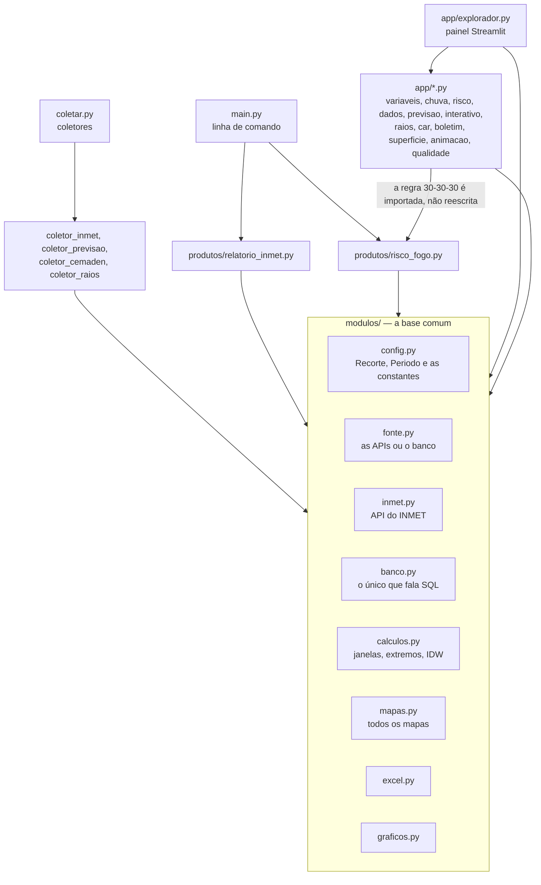

# Guia de manutenção

Para quem vai mexer no código: o que existe, como as peças se encaixam e onde mexer para cada tipo de mudança. O [README](../README.md) descreve o projeto do ponto de vista de quem **usa**; este guia é para quem **mantém**.

Uma leitura de ponta a ponta leva uns 20 minutos. Depois, ele serve de consulta: as seções 6 (receitas) e 8 (armadilhas) são as que mais se volta a abrir.

**Sumário**

1. [O projeto em um minuto](#1-o-projeto-em-um-minuto)
2. [Seis ideias que atravessam tudo](#2-seis-ideias-que-atravessam-tudo)
3. [O caminho de um `python main.py`](#3-o-caminho-de-um-python-mainpy)
4. [O caminho do painel](#4-o-caminho-do-painel)
5. [Arquivo por arquivo](#5-arquivo-por-arquivo)
6. [Receitas: onde mexer para cada mudança](#6-receitas-onde-mexer-para-cada-mudança)
7. [Testes](#7-testes)
8. [Armadilhas conhecidas](#8-armadilhas-conhecidas)
9. [Versões, branches e publicação](#9-versões-branches-e-publicação)
10. [Onde está o porquê de cada coisa](#10-onde-está-o-porquê-de-cada-coisa)

---

## 1. O projeto em um minuto

São **três portas de entrada** sobre **uma base comum**:

- **`main.py`**, a linha de comando: gera os **produtos** (planilha Excel e mapas em PNG) que vão para o boletim. É o que a equipe mais usa.
- **`app/explorador.py`**, o painel em Streamlit: serve para **olhar** os dados (mapas navegáveis ou do boletim, gráficos, qualidade). Ele não grava nada em `saida/`.
- **`coletar.py`**, os coletores do banco da UNIGEO: rodam no servidor, pelo Agendador de Tarefas, e guardam o INMET, a previsão, o CEMADEN e a contagem dos raios.

As três usam o mesmo código de `modulos/`: a mesma API, as mesmas contas e o mesmo desenho de mapa. É por isso que a tela e o relatório não discordam.



A regra de dependência é uma só: **`modulos/` nunca importa nada de `app/`**. O painel conhece os produtos, mas os produtos não sabem que o painel existe. Mantida essa regra, o `main.py` roda sem Streamlit instalado.

E uma segunda, desde a v0.3.1: **os produtos e o painel pedem os dados ao `modulos/fonte.py`, e nunca direto ao `inmet.py`.** É o `fonte.py` que decide de onde vêm as leituras e a previsão, pela configuração `FONTE_DADOS`: `apis` (as APIs públicas, o padrão) ou `banco` (o `climageo`, desde a 0.4.1). A API de leitura chega numa próxima versão ([`plano_arquitetura.md`](plano_arquitetura.md)). Um teste (`test_produtos_e_painel_pedem_os_dados_a_fonte_e_nao_ao_inmet`) falha se alguém passar por fora.

Tamanho de cada parte, para ter noção do que se está mantendo:

| Parte | Linhas | O que tem |
|---|---|---|
| `modulos/` (base, produtos e coletores) | ~5.000 | `config`, `fonte`, `inmet`, `banco`, `openmeteo`, `cemaden`, os quatro coletores, `calculos`, `mapas`, `geotiff`, `gpkg`, `excel`, `graficos` e os dois produtos |
| `app/explorador.py` | ~5.300 | a tela inteira do painel: as páginas do observado e da previsão, e a dos raios |
| `app/*.py` (os outros) | ~3.100 | as contas do painel, sem tela, por isso testáveis |
| `tests/` | ~8.800 | 772 testes, que rodam em ~50 s |

---

## 2. Seis ideias que atravessam tudo

Entendidas estas seis, o resto do código se lê sozinho.

### 2.1 O `Recorte`: qual estado é

`config.Recorte` reúne tudo o que muda de um estado para outro: a sigla, o nome, os dois shapefiles, o **enquadramento** do mapa (`limites`) e o **fuso**. Ele é passado de função em função (`carregar_base(recorte)`, `estacoes_do_recorte(recorte)`…), e não lido de uma constante global. É isso que deixa duas pessoas olharem estados diferentes no mesmo painel, ao mesmo tempo.

- `config.recorte_de("SC")` monta o recorte de qualquer UF que tenha shapefile em `shp/`. O de MS é escrito à mão em `config.RECORTES`, com o enquadramento de sempre. O dos outros é derivado do contorno, mais uma margem de 0,35°.
- `config.ufs_disponiveis()` lista as UFs que têm shapefile, e é isso que aparece no seletor do painel e no `--uf`.
- Quem não passa recorte recebe o padrão, `config.RECORTE`, que é MS.

### 2.2 O `Periodo` e a regra de ouro das janelas

`config.Periodo` é a janela de uma consulta: `inicio`, `fim`, `modo` (`"dia"`, `"periodo"` ou `"tempo_real"`) e `fuso`. Ele é criado por `Periodo.de_datas(...)` ou `Periodo.tempo_real(...)`.

Duas convenções valem **no projeto inteiro**, e a maioria dos defeitos já corrigidos foi alguém escorregando numa delas:

1. **Toda janela é `(início, fim]`.** Cada leitura do INMET resume a hora que **termina** nela: a leitura das 15:00 cobre de 14:00 a 15:00. Por isso entra a leitura do fim e não a do início.
2. **A leitura das 00:00 fecha o dia anterior.** O dia 17/09 vai da leitura da 01:00 de 17/09 até a das 00:00 de 18/09. Quem agrupa por dia sem recuar essa hora transforma uma semana em oito dias, o último com uma leitura só. As funções que já fazem isso certo: `risco_fogo.dia_da_leitura`, `qualidade.dia_da_leitura`, `variaveis._fatias`, `chuva._comeco_do_mes`.

E o dia é o **do estado**: o fuso vem do recorte (MS e MT em GMT-04, PR e SC em GMT-03), e é ele que decide onde o dia começa.

### 2.3 Estações do estado e estações de apoio (as vizinhas)

Os mapas interpolados usam também as estações de **fora** do estado que podem estar entre as 8 mais próximas de alguma célula do mapa. São as **vizinhas**, ou **apoio**. Sem elas, na divisa o IDW só enxerga estações de um lado e extrapola.

A regra é rígida: **o apoio entra só na superfície**. Ele não vira ponto desenhado, linha de planilha, ranking, nem critério de qual hora ganha mapa no risco de fogo. E a escala de cores fica presa na faixa que o estado faria sozinho (`mapas.mapa_interpolado`).

- Quem escolhe as vizinhas é `inmet.estacoes_de_apoio`, chamada pelo `fonte.estacoes_de_apoio` (com a fonte "banco", a mesma escolha sai do cadastro do banco): elas precisam cair a até 1,5° do enquadramento e chegar às 16 mais próximas de alguma célula (`config.VIZINHOS_NA_PODA`, o dobro do que o IDW usa, por folga).
- Painel e produtos usam a **mesma** função, então a tela e o boletim saem das mesmas estações.
- Se a lista falhar, `inmet.baixar_apoio` avisa e devolve vazio, e o produto sai só com as do estado.

### 2.4 Unidades: o vento chega em m/s

A API manda velocidade e rajada em **m/s**. O projeto mostra tudo em **km/h**, e a conversão é feita **uma vez só**, em lugares conhecidos:

- no `relatorio_inmet`, dentro de `resumir_estacao` (`VEN_RAJ * 3.6`);
- no `risco_fogo`, em `leituras_validas` (coluna `rajada_kmh`);
- no painel, ao carregar, por `CONVERSOES` no topo do `explorador.py`. Daí em diante, todo o painel já trabalha em km/h.

O perigo é converter duas vezes: `app/risco.py` recebe o dado do painel, que já está em km/h, e um teste trava isso (`test_a_rajada_nao_e_convertida_de_novo`). Converter de novo daria 130 km/h num dia calmo.

### 2.5 Um desenho de mapa, duas molduras

Todo mapa em PNG sai de `modulos/mapas.py`. O que muda entre o relatório e a tela é a **moldura**:

- **Sem `Tela`** (o caminho do `main.py`): título e subtítulo (o quê e quando, sem as instituições), logos, ranking das 5 estações, barra de cores vertical, grade de latitude e longitude e, no rodapé, o crédito ("Dados: INMET/SEMADESC", "INMET/SEMADESC/CEMADEN" quando há pluviômetro do CEMADEN, ou o do Open-Meteo na previsão).
- **Com `mapas.Tela(...)`** (o caminho do painel, na vista Boletim): só o desenho, para caber na tela.

O item "PNG do boletim (300 dpi)" do menu "Baixar" chama o caminho **sem** `Tela`, com as cores da tela. O texto da moldura vem de `app/boletim.py`.

A exceção é a **vista Navegável** do painel: ela é desenhada no navegador, pelo pydeck, com as camadas montadas em `app/interativo.py`. É um segundo desenho, mas a **conta** é a mesma: a superfície sai do mesmo IDW (ou da mesma bilinear, na previsão), na mesma grade dos produtos, e o GeoTIFF (`modulos/geotiff.py`) refaz a mesma conta em pixels de 0,01°.

O que vai num mapa é descrito por uma especificação: `EspecMapa` para valores contínuos (coluna, título, paleta, unidade, ranking, setas de vento) e `EspecClasses` para classes, como os níveis de risco.

### 2.6 No painel, a regra é da variável

`app/variaveis.py` é o **catálogo** do painel. Cada `Produto` ("Temperatura máxima", "Rajada na hora"…) diz de que colunas da API ele sai, em que modos existe (hora, dia, período), qual conta o define e a frase da regra, que vai impressa na tela. Ninguém escolhe "média" ou "máxima" na tela: a máxima do dia é **sempre** a maior das máximas horárias. O mapa e o gráfico usam a mesma regra, então não podem discordar.

O catálogo também decide a **escala de cores** (`variaveis.escala`): temperatura de 0 a 45 °C, umidade de 0 a 100%, vento de 0 a 130 km/h, e a chuva por classes que dependem da duração da janela.

---

## 3. O caminho de um `python main.py`

```bash
python main.py --produto relatorio_inmet --uf MS --dataini 29/09/2026
```

1. **`main.py` → `ler_consulta()`**: lê os argumentos, ou as variáveis no topo do arquivo quando eles faltam. Devolve três coisas: o **módulo do produto** (de `PRODUTOS`, que associa o `NOME` de cada produto ao seu módulo), o **`Periodo`** (com o fuso do recorte) e as **`opcoes`** (`{"recorte": ..., "hrtodas": ..., "retirar": ...}`, com as estações retiradas do `RETIRAR` ou do `--retirar`).
2. **`main.executar()`**: confere se o token está no `.env` e chama `produto.executar(periodo, opcoes)`. **Todo produto tem essa mesma assinatura**: é o contrato que o `main.py` conhece.
3. Dentro do produto, no `relatorio_inmet.executar`:
   1. `fonte.leituras_do_estado(...)` devolve uma lista de pares `(estação, leituras)` das estações operantes da UF (as em pane ficam de fora). Com a fonte `apis`, ele repassa ao `inmet.baixar_estacoes`, que baixa as leituras de cada estação, **uma por vez**, com até 3 tentativas por consulta, e imprime quem ficou de fora e por quê. Com a fonte `banco`, lê as mesmas colunas do `climageo`, numa consulta.
   2. `resumir_estacao` calcula, para cada estação, os extremos e os acumulados da janela, com `calculos.recortar`, `indice_extremo` e `acumulado_chuva`.
   3. `montar_tabelas` monta uma tabela por aba do Excel, ordenada.
   4. `excel.salvar_relatorio` grava a planilha.
   5. `mapas.carregar_base(recorte)` lê os shapefiles e monta a grade. `_tabelas_de_apoio` baixa as vizinhas e faz as mesmas tabelas para elas, e `_sem_as_retiradas` tira dos mapas as estações retiradas.
   6. `mapas.gerar_mapas(tabelas, especificacoes_mapas(...), ...)` desenha, para cada especificação, o mapa pontual e o interpolado.
4. O `risco_fogo.executar` segue o mesmo esqueleto, com a conta própria no meio:
   1. `leituras_validas` guarda só as horas com as três variáveis, já com a rajada em km/h.
   2. `analisar_horas` avalia cada hora: `estacoes_na_hora` dá o nível de cada estação naquela hora, e `grade_da_hora` interpola as **três variáveis separadas** e aplica a regra célula a célula.
   3. `resumir_estacao` e `montar_tabela` montam a planilha.
   4. `gerar_mapas` desenha os mapas de síntese e os horários, e `gerar_graficos` os gráficos, só no período.

Tudo vai para `saida/<produto>/<modo>/<identificador>/` (`Periodo.pasta_saida`), que fica fora do git.

---

## 4. O caminho do painel

### 4.1 Como o Streamlit roda

O Streamlit **executa o `explorador.py` inteiro, de cima a baixo, a cada clique**. Não há "eventos": mexer num filtro faz o script rodar de novo, e é o cache que impede que isso refaça tudo. Três mecanismos seguram o estado:

| Mecanismo | Onde | Para quê |
|---|---|---|
| `@st.cache_data` | `carregar_leituras`, `mapa_do_instante`, `risco_avaliado`… | Guarda o **resultado** pela combinação de argumentos, e devolve uma cópia. Argumentos com `_` na frente não entram na chave. |
| `@st.cache_resource` | `base_cartografica`, `malha_fina`, `guarda_da_previsao` | Guarda o **mesmo objeto**, sem copiar: os shapefiles, que são pesados, e a previsão guardada por rodada, que é uma só para todos. Tem `max_entries=3` porque esse cache é **do processo**, compartilhado por todo mundo na nuvem. Um teste exige o teto. |
| `st.session_state` | botões "Gerar GIF", "Carregar todas as estações"; os filtros da barra lateral | Lembra que um botão já foi apertado, entre uma execução e outra, e o que se escolheu nos filtros quando se troca de página (`lembrar_filtros`). |

Além disso, há o **cache em disco** de `app/dados.py`: um `cache/<código da estação>.pkl` por estação, fora do git. Alargar o período baixa só os dias que faltam. As horas recentes que chegaram sem medida são consultadas de novo, porque o INMET publica a linha da hora antes de preenchê-la.

### 4.2 Como o `explorador.py` está organizado

É o maior arquivo do projeto, mas segue uma ordem fixa, em seções marcadas por um cabeçalho em maiúsculas (`# ===`). Cada página é uma função `pagina_*`, e o `st.navigation` do fim do arquivo as reúne:

| Linhas (aprox.) | O que tem |
|---|---|
| 1–120 | imports e constantes da tela (`DPI_MAPA`, `MAPAS_POR_LINHA`, os textos de ajuda do GeoTIFF, `ESTADOS_NA_MEMORIA`…) |
| 120–1115 | funções comuns: as carregadas em cache (`carregar_*`, `mapa_do_*`, `gif_*`), a gaveta das estações retiradas (`gaveta_das_retiradas`), o menu "Baixar" (`menu_de_baixar`, `botao_do_boletim`, `botao_do_geotiff`) e os pedaços de tela reutilizados (`painel_do_mapa`, `painel_da_chuva`…); perto de 1280, `CHAVES_DOS_FILTROS` e `lembrar_filtros` |
| ~1120 | **PREVISÃO**: a busca e a guarda das rodadas (`guarda_da_previsao`), os gráficos e os mapas da previsão em PNG |
| ~1568 | **FILTROS EM COMUM**: o estado e o período (`filtros_de_estado_e_periodo`) |
| ~1601 | **MAPAS INTERATIVOS**: a vista navegável do observado (`mapa_interativo`, `mapa_navegavel_da_variavel`, `mapa_navegavel_da_chuva`, o agrupamento de 15 km dos números em `com_o_maior_do_grupo`, o ponto clicado, o imóvel do CAR em `imovel_da_barra`, o 3D). As peças de pydeck de cada camada vêm de `app/camadas.py` |
| ~2456 | **PÁGINAS DO OBSERVADO**: `pagina_mapas` (com as séries e a qualidade dos dados), `pagina_chuva` (com carga própria, porque os acumulados olham para trás do período) e `pagina_risco` (o mesmo dado da página Mapas) |
| ~3223 | **MAPAS INTERATIVOS DA PREVISÃO**: a vista navegável da previsão, por dia, hora a hora e por semana |
| ~3990 | **PÁGINAS DA PREVISÃO**: a barra lateral (`barra_da_previsao`), o boletim hora a hora e o GIF, os gráficos da estação, e `pagina_mapas_previstos`, `pagina_chuva_prevista`, `pagina_risco_previsto` e `pagina_semanas` |
| ~4668 | **RAIOS**: o Agora (num `st.fragment` que se refaz a cada minuto), a densidade e `pagina_raios` |
| ~5133 | **CICOE: O MAPA DE CAMADAS**: a chuva da janela (`chuva_das_camadas`), as cargas dos serviços de fora, com cache que não guarda a falha (`pontos_do_servico`, `nomes_dos_tipos`, `foto_do_ponto`), o tempo na hora da observação (`condicoes_no_ponto`), a ficha (`ficha_do_ponto`), o corpo da página num `st.fragment` que se refaz a cada minuto (`corpo_das_camadas`: os filtros e o quadro em cima, o mapa e a ficha embaixo, as legendas sob o mapa) e `pagina_camadas` |
| ~5488 | `lembrar_filtros()` e o `st.navigation` com os três grupos. A página Raios só entra quando `fonte.tem_raios()` |

Em cada página do observado e da previsão, os controles comuns (a agregação, a variável, o instante e o seletor "Mapa: Navegável | Boletim") ficam em cima, e a vista escolhida chama a função dela (`mapa_navegavel_*` ou `boletim_*`/`painel_do_*`) com as mesmas escolhas. Trocar de vista não consulta de novo, porque a carga em cache é a mesma.

**As páginas.** O painel tem o grupo "Observado" (Mapas, Chuva, Risco de Fogo e Raios), o grupo "Previsão (MS)" (Mapas, Chuva, Risco de Fogo e Semanas) e o grupo "CICOE (em desenvolvimento)" (Mapa de camadas), trocadas no topo da barra lateral. O Streamlit apaga o valor de um widget que não aparece numa execução, e cada página aparece sozinha: sem cuidado, ir à previsão e voltar perderia as estações escolhidas. Um filtro novo da barra lateral que deva sobreviver à troca precisa de três coisas: uma `key`, entrar em `CHAVES_DOS_FILTROS`, e receber o valor inicial com `st.session_state.setdefault` antes do widget, **e não** pelo parâmetro (`default=`, `index=`). Com o valor nos dois lugares, o widget volta vazio na tela enquanto o painel usa o valor guardado. O período é a exceção, explicada em `lembrar_filtros`.

A regra de organização: **conta vai para um módulo de `app/` sem Streamlit; tela fica no `explorador.py`**. `variaveis`, `chuva`, `risco`, `dados`, `previsao`, `interativo`, `camadas`, `servicos`, `raios`, `car`, `referencia`, `boletim`, `animacao`, `superficie` e `qualidade` não importam `streamlit`, e é por isso que têm testes. O `explorador.py` não tem teste direto: ele é verificado abrindo o painel.

---

## 5. Arquivo por arquivo

### `modulos/` — a base comum

| Arquivo | Para que serve | Você mexe aqui quando… |
|---|---|---|
| `config.py` | `Recorte`, `Periodo` e **todas as constantes**: limiares do 30-30-30, IDW, DPI, logos, URLs, tentativas, cores do risco | quer mudar um número que vale para o projeto todo |
| `fonte.py` | de onde vêm os dados: as funções que os produtos e o painel chamam (`estacoes`, `leituras_do_estado`, `leituras_de_apoio`, `previsao`, `semanas`…), e a escolha da fonte pela configuração `FONTE_DADOS`. Com `apis`, repassa ao `inmet.py` e ao `openmeteo.py`; com `banco`, lê do `climageo` com o usuário que só lê e devolve as mesmas colunas. O CEMADEN (`estacoes_cemaden`, `chuva_cemaden`) e os raios (`tem_raios`, `raios_*`) só vêm do banco: com `apis`, voltam vazios | uma fonte nova entra (a API de leitura), ou um dado novo passa a vir do banco |
| `inmet.py` | toda conversa com a API: lista de estações, dados horários (por estação e, para o coletor, de todas as estações numa hora: `baixar_hora`), tentativas, vizinhas, resumo de quem ficou de fora. O token sai das mensagens de erro (`_sem_token`). O INMET aceita **100 consultas por minuto por endereço de rede** e, passado o limite, responde 200 com um aviso no lugar do JSON: o `_consultar` reconhece o aviso e espera, dobrando a espera, sem gastar tentativa. | a API muda, ou a forma de baixar |
| `banco.py` | o banco da UNIGEO (PostgreSQL 16, schema `climageo`): a **única peça que fala SQL**. Conecta com o papel certo (`conectar("gravacao" / "leitura" / "teste")`, pelas variáveis `BANCO_*` do `.env`), cria o esquema (`criar_esquema`, pelo `banco/esquema.sql`), cria e apaga as partições (o banco não tem pg_partman nem pg_cron), grava em lote (`gravar_previsao`, `gravar_semanas`, `gravar_inmet`, `gravar_estacoes`) e lê de volta, nas colunas que o resto do projeto já usa. Guarda só as horas; o dia sai delas na leitura. | muda uma tabela, ou o jeito de gravar |
| `coletor_inmet.py` | o coletor do INMET, chamado pelo `coletar.py`: o cadastro pela lista do INMET, os últimos 3 dias de todas as estações (`coletar_ultimas`, `HORAS_REBUSCADAS`), a sensação térmica, a bateria e o processador por estação (`coletar_extras`) e o histórico (`carregar_historico`), que retoma de onde parou. No máximo uma consulta por segundo (`config.INTERVALO_DO_COLETOR`): 60 das 100 do minuto, e sobram 40 para a equipe. A radiação é gravada com uma casa, como na consulta por estação, para o banco devolver o mesmo número que a API. | muda o que se coleta, ou o ritmo |
| `cemaden.py` | toda conversa com a PED do CEMADEN: o login (o token vale 4 horas e é renovado aos 3,5; a PED o recusa às vezes antes disso, com HTTP 400 e "O Token informado é inválido!", e aí o cliente entra de novo e repete a consulta), o cadastro do estado (`cadastro`, `esta_parada`) e a chuva de um dia UTC do estado inteiro numa consulta (`chuva_do_dia`, `ler_chuva`). No máximo uma consulta a cada 6 s (`config.INTERVALO_CEMADEN`): a PED aceita 12 por minuto por conta. O token carrega o usuário e a senha dentro, então nunca vai para log nem para arquivo; as mensagens de erro saem sem a conta (`_sem_credenciais`). os termos da PED pedem a citação "DATA FROM THE CEMADEN/MCTIC OBSERVATIONAL NETWORK", e a equipe preferiu o crédito em português (`mapas.CREDITO_COM_CEMADEN`, "INMET/SEMADESC/CEMADEN"), que o `boletim.credito` escolhe quando o mapa tem estação do CEMADEN | a PED muda, ou a forma de consultar |
| `coletor_cemaden.py` | o coletor do CEMADEN, chamado pelo `coletar.py cemaden`: o cadastro a cada execução, os últimos 3 dias UTC (`coletar_ultimos`) e o histórico em lotes de 10 dias (`carregar_historico`), que pula os dias já guardados e busca sempre de novo os últimos 3. A estação que não está no cadastro da PED entra pelas leituras (`estacoes_das_leituras`). Depois de 4 dias seguidos sem resposta, a carga para, e o `coletar.py` espera 15 minutos e retoma | muda o que se coleta da PED |
| `coletor_previsao.py` | o coletor da previsão, chamado pelo `coletar.py previsao` de hora em hora: confere a rodada mais recente de cada modelo e guarda só as das 00Z e 12Z (as das 06Z e 18Z o Open-Meteo completa com a anterior), na grade de 0,25° (`GRADE_DO_COLETOR`) e nos pontos das estações; o EC46 por semana; recupera pela API das rodadas avulsas a rodada dos últimos 7 dias que passou (`rodadas_que_faltam`, `recuperacoes`), uma a cada 4 horas; e apaga as partições da grade com mais de 21 dias. A conferência que não acha rodada nova só lê os metadados, que não gastam cota | muda um modelo, a grade ou quanto tempo se guarda |
| `coletor_raios.py` | o coletor dos raios, chamado pelo `coletar.py raios` de 10 em 10 minutos: lê no controle das tabelas do GLM (as que um colega alimenta, `config.GLM_SCHEMA`) os arquivos de 20 s que entraram desde a última vez, e reconta por hora e por célula de 0,1° (`raios_glm_hora`) só as horas que mudaram (`a_recontar`). A contagem roda no próprio servidor, numa consulta que apaga e grava a hora inteira: rodar de novo não duplica nada | muda a célula, a caixa do estado ou o que se conta |
| `retiradas.py` | as estações que a equipe tira dos mapas de uma variável (sensor com defeito à espera da correção do INMET): as variáveis que têm lista (`VARIAVEIS`, as grandezas do painel e o Risco de Fogo), a leitura do `--retirar` (`ler_pedidos`), o nome sem acento ou o código do INMET (`resolver`) e o corte da tabela (`retirar`). Sai só do mapa, do ranking e da interpolação; planilhas, tabelas e gráficos ficam com todas. No painel, as listas vivem no `st.session_state["retiradas"]` | uma variável nova ganha lista, ou muda o que a retirada alcança |
| `openmeteo.py` | a previsão do Open-Meteo: os pontos (grade com uma fileira além da divisa, e as estações), a rodada de cada modelo pelos metadados, os pedidos em lotes que cabem no limite de 600 por minuto, e o dia tirado das horas pela regra do projeto (`diario`). As semanas (`buscar_semanas`) vêm da API sazonal: as anomalias do EC46, na média dos membros, com a rodada pelos metadados do `ecmwf_ec46`. Os modelos, os 14 dias, os 46 das semanas e o espaçamento da grade ficam em `config.py`. | o Open-Meteo muda, ou muda um modelo, uma variável ou a grade |
| `arcgis.py` | camadas de pontos de um ArcGIS Feature Service público (o PIN MS): os pontos com só os campos pedidos e em páginas (`pontos`), o nome por extenso de um campo de domínio (`dominio`) e a primeira foto anexada (`primeira_foto`). Recusa pedir um campo proibido, sem diferenciar maiúsculas, e descarta o campo que o servidor mande sem ter sido pedido. A falha do servidor vira `ErroArcgis`. Não sabe o que o ponto significa: isso é do `app/servicos.py` | o PIN MS muda a forma de consultar, ou entra um serviço que não é de pontos |
| `calculos.py` | contas puras: `recortar` (a janela `(início, fim]`), extremos, acumulado de chuva, `criar_grade`, `interpolar_idw` (distâncias em km), `apoio_que_entra` | quer mudar como se interpola ou se recorta no tempo |
| `mapas.py` | todos os desenhos: `mapa_pontual`, `mapa_interpolado`, `mapa_de_grade`, os de classes, logos, ranking, setas de vento; `EspecMapa`, `EspecClasses`, `Tela`, `BaseCartografica`. O crédito do subtítulo é o `credito` da espec: "INMET/SEMADESC" por padrão, o do Open-Meteo na previsão. Classes de larguras desiguais (chuva, radiação, anomalias) são pintadas uma cor por classe, como a barra da tela; níveis iguais, como os do `main.py`, pela régua do valor. `ranking_absoluto` ranqueia pelo tamanho do desvio, nas anomalias | o **visual** de um mapa muda, nos dois lados |
| `geotiff.py` | o GeoTIFF dos mapas do painel, no padrão das camadas do PIN MS: SIRGAS 2000 (EPSG:4674), pixel de 0,01°, NoData fora do estado (`grade_do_estado`). O IDW é refeito em cada pixel (`idw`); o risco vai pelo vizinho mais próximo, com a paleta (`gravar_classes`). Gravado só com o Pillow, com as tags do GeoTIFF e do GDAL escritas à mão | muda a resolução, o sistema de referência ou o que o GeoTIFF leva |
| `gpkg.py` | o GeoPackage das estações de um mapa (`tabela_das_estacoes`, `gravar`), com o estilo do QGIS dentro, na tabela `layer_styles` (`ESTILO_QML`) | muda o que vai na camada ou o estilo |
| `excel.py` | grava as tabelas num `.xlsx`, uma aba por tabela | o formato da planilha muda |
| `graficos.py` | barras empilhadas, agrupadas e calendário, no estilo comum | um produto precisa de gráfico |
| `produtos/relatorio_inmet.py` | o relatório: o que se calcula por estação, quais abas e **quais mapas** (`especificacoes_mapas`, com títulos e paletas) | muda o conteúdo do boletim |
| `produtos/risco_fogo.py` | a regra 30-30-30 hora a hora, a planilha, os mapas (`espec_nivel_maximo`, `espec_da_hora`…) e os gráficos do período | muda o risco de fogo, no `main.py` **e** no painel |

### `app/` — o painel

| Arquivo | Para que serve |
|---|---|
| `explorador.py` | a tela (seção 4.2) |
| `variaveis.py` | o catálogo de produtos do painel (`PRODUTOS`), as regras de agregação (`CALCULOS`), a escala de cores (`escala`) e o que já vem escolhido (`PADRAO_MAPA`) |
| `dados.py` | a coleta com cache em disco e download em paralelo (8 por vez), e o CSV com as 29 colunas da API |
| `chuva.py` | as janelas dos acumulados (3 a 96 h, o mensal e o do período), `cobre` (o dado carregado alcança a janela?) e as cascatas |
| `risco.py` | traduz o dado do painel para o formato do `risco_fogo` e de volta. **Não** reimplementa a regra. |
| `boletim.py` | o texto da moldura do PNG do boletim: título, subtítulo, ranking, nome do arquivo |
| `animacao.py` | os GIFs: quais quadros entram e o carimbo de cada um |
| `superficie.py` | a superfície como imagem transparente, para o mapa navegável |
| `interativo.py` | o que vai em cada camada do mapa navegável (pydeck), sem tela: a grade invisível que dá o valor em qualquer ponto (`grade_do_ponto`, `celulas_da_grade`, `celulas_do_risco_na_grade`), o texto do balão (`texto_do_ponto`, com casas a mais perto de um limiar), os pontos das estações e do CEMADEN, os blocos do 3D (`relevo`, `relevo_de_classes`) e as séries do ponto clicado (`serie_do_ponto`, `serie_da_chuva_no_ponto`…). `ESTILO_SEM_FUNDO` é o estilo sem mapa de fundo, para quando a caixa "Mapa de fundo" está desligada |
| `camadas.py` | as peças de pydeck que os mapas navegáveis dividem (os limites, as estações e os pluviômetros, a imagem da superfície, os quadradinhos e os flashes dos raios, os rótulos, o `deck` com e sem o mapa de fundo, a legenda) e o quadro do mapa de camadas: o catálogo das nossas camadas (`CATALOGO`, `disponiveis`), o quadro inicial, as camadas empilhadas de baixo para cima (`empilhadas`, que trata a célula esvaziada) e a montagem que só constrói o que está ligado (`montar`) |
| `servicos.py` | os serviços de fora no mapa de camadas: cada um é um `Servico` (o endereço, o papel de cada campo, o ícone de cada tipo e os campos proibidos) na lista `SERVICOS`, hoje só o `CICOE`. Faz os pontos com a referência da janela de tempo (`pontos_do_servico`, `desde`), a camada de ícones (`camada`), a legenda, a foto sem os metadados (`foto_sem_metadados`), as contas do tempo na hora da observação (`chuva_no_local`, o IDW no ponto com o centro do recorte, que dá o número da cor do mapa; `mais_perto`, `pluviometros_candidatos`, com o limite de 50 km, `leitura_da_hora`, `chuva_ate`, `flashes_em_volta`) e o HTML da ficha (`ficha`) |
| `raios.py` | as contas da página Raios: a cor e a faixa de cada flash pela idade (`IDADES`), o círculo do Agora (`agora_no_circulo`, `aneis`), as barras de 5 minutos, a densidade por km² (`densidade`, `classe`) e as horas que faltam no banco (`horas_que_faltam`) |
| `car.py` | o imóvel do CAR: reconhece o tipo de cada arquivo pelo conteúdo (`reconhecer`), lê shapefile, GeoJSON, GeoPackage, KML e KMZ, também dentro de .zip (`ler`), lê coordenadas em graus decimais ou em graus, minutos e segundos (`ler_coordenadas`) e acha as células da grade que o imóvel toca (`celulas_do_imovel`, `resumo`). Tudo na memória |
| `referencia.py` | a localização das estações: o município de cada uma (`tabela_de_referencia`, pelo começo do nome ou pelo ponto), o CEMADEN junto (`com_o_cemaden`) e a busca sem acento (`procurar`) |
| `qualidade.py` | as conferências da aba de qualidade: completude, valores impossíveis, sensores travados |
| `previsao.py` | as contas das páginas de previsão: a cópia guardada de cada modelo até a rodada seguinte (`Guarda`), o catálogo dos gráficos (`GRANDEZAS`) e as séries de cada estação; o catálogo dos mapas do dia (`MAPAS`) e da hora (`MAPAS_DA_HORA`), a escala (a do observado), o acumulado e a `superficie`, que leva a grade do modelo (0,5° na busca direta, 0,25° no banco) à do mapa por interpolação bilinear, e `vizinhos`/`no_ponto`, a mesma bilinear num ponto só; o catálogo das semanas (`MAPAS_SEMANAIS`), com as escalas divergentes, e quais semanas estão inteiras; e o risco de fogo previsto, com a regra do `risco_fogo` usada como está: o nível de cada hora (`risco_por_hora`), o pior nível e as horas em risco alto do dia (`diario_com_risco`), e a grade do dia, com a regra aplicada célula a célula, hora a hora (`risco_na_grade`). A busca é do `modulos/openmeteo.py`. |
| `requirements.txt` | as dependências **do painel**. É o que se instala para rodar o painel; o da branch `streamlit` é o que o Streamlit Cloud instala. |

### O resto

| Caminho | Para que serve |
|---|---|
| `shp/` | dois shapefiles por UF, `<UF>_UF_2022` (contorno) e `<UF>_mun_simplificado` (municípios), e o `brasil_e_vizinhos.gpkg` dos mapas largos dos raios. **Precisam estar no git**: a nuvem clona o repositório e não baixa nada na hora. |
| `img/` | os logos dos mapas (PNG transparente). A posição deles fica em `config.LOGOS`. |
| `ferramentas/simplificar_municipios.py` | gera os shapefiles de uma UF a partir da malha 2022 do IBGE (`--uf GO`, `--refazer`) |
| `ferramentas/trava_glm.py` | liga e desliga (`parar`, `retomar`, `estado`) o gatilho que recusa a gravação na tabela de raios do colega (`relampagos_glm_rt`) enquanto ela não é recortada, sem renomeá-la: renomear pede trava exclusiva, que espera qualquer leitura longa (um pg_dump, o ArcGIS) e bloqueia as outras enquanto espera |
| `ferramentas/brasil_e_vizinhos.py` | gera o `shp/brasil_e_vizinhos.gpkg`: os estados do Brasil (dos contornos do IBGE em `shp/`) e os países em volta (do Natural Earth), simplificados |
| `coletar.py` | a linha de comando dos coletores do banco: `esquema` (cria as tabelas que faltam), `inmet` (de hora em hora), `inmet --extras` (uma vez por dia), `inmet --revisar 30` (uma vez por semana), `inmet --historico DATA`, `previsao` (de hora em hora), `cemaden` (de hora em hora), `cemaden --historico DATA` e `raios` (de 10 em 10 minutos). Com `--teste`, grava no `climageo_teste`, com a conexão de teste. Sai com código 1 quando o banco ou alguma consulta falham, para o Agendador marcar. |
| `servidor/coletar.bat` | chama o `coletar.py` pelo Agendador de Tarefas, com a saída em `logs/coletor_<trabalho>.log` (`coletar.bat inmet` grava em `logs/coletor_inmet.log`, `coletar.bat inmet --extras` em `logs/coletor_inmet_extras.log`, e `coletar.bat cemaden` em `logs/coletor_cemaden.log`) |
| `servidor/criar_tarefas.ps1` | cria (ou recria) as seis tarefas dos coletores no Agendador: o INMET de hora em hora aos 50 minutos, os extras às 03:00, a revisão de 30 dias aos domingos à 01:05, a previsão de hora em hora aos 15 minutos, o CEMADEN de hora em hora aos 5 minutos e os raios de 10 em 10 minutos. As tarefas rodam o código da pasta em que o script rodou, na branch que estiver nela |
| `banco/esquema.sql` | as tabelas do banco, sem o schema na frente: o `banco.py` aponta para o `climageo` (ou o `climageo_teste`) ao conectar. Pode rodar de novo. As tabelas têm de ser do usuário que grava, porque o coletor cria e apaga as partições. |
| `servidor/iniciar_painel.bat` | sobe o painel no servidor Windows da unidade, chamado pelo Agendador de Tarefas. A porta vem da variável `PORTA` (padrão 8501), a saída vai para `logs/painel.log`, fora do git, e o observador de arquivos fica **desligado**: depois de uma atualização, o painel só muda quando a tarefa é reiniciada, em vez de rodar metade código novo e metade velho |
| `.gitattributes` | obriga os `.bat` a ter quebra de linha do Windows (CRLF): com LF, o `cmd.exe` pode pular comandos |
| `legado/` | os scripts originais, só para comparação. Não são usados por nada. |
| `docs/` | este guia, o de migração, as decisões da meteorologia, o escopo da 0.2.2 e as imagens do README |
| `tests/` | seção 7 |
| `.github/workflows/testes.yml` | a CI: roda o pytest no Python 3.14 a cada push, em qualquer branch, e a cada PR para a `main`. Os testes do banco rodam num PostgreSQL 16 com PostGIS que sobe vazio só para eles, com uma senha que só existe ali |
| `requirements.txt` / `requirements-dev.txt` | dependências da linha de comando / mais o pytest |
| `.env` | o token do INMET, a fonte (`FONTE_DADOS`), as conexões do banco (`BANCO_*`) e a conta da PED (`CEMADEN_*`). **Nunca vai para o git.** O modelo é o `.env.example`. |

---

## 6. Receitas: onde mexer para cada mudança

Depois de qualquer receita: `pytest`, e, se mexeu no painel, abrir o painel e olhar.

**Mudar um limiar do 30-30-30.** Use `config.LIMIAR_TEMP_MAX`, `LIMIAR_UMIDADE_MIN` e `LIMIAR_RAJADA`. Vale para o `main.py` e para o painel ao mesmo tempo, porque o painel importa a regra. As legendas se ajustam sozinhas (`risco_fogo.rotulos_condicoes`). Para mudar a partir de que nível uma hora ganha mapa horário: `config.NIVEL_MAPA_HORARIO`.

**Mudar a interpolação.** Use `config.IDW_VIZINHOS`, `IDW_POTENCIA`, `RESOLUCAO_GRADE` e `MIN_ESTACOES_INTERPOLACAO`. Muda todos os mapas, nos dois lados. Se mexer em `IDW_VIZINHOS`, o `VIZINHOS_NA_PODA` acompanha, porque é o dobro.

**Mudar o título, a paleta ou o ranking de um mapa do relatório.** Use `relatorio_inmet.especificacoes_mapas`: cada `EspecMapa` ali é um mapa. Para os do risco de fogo, use as funções `espec_*` do `risco_fogo.py`. Elas também alimentam o PNG do boletim do painel, então a mudança vale nos dois lugares.

**Acrescentar um mapa ao relatório.** A coluna precisa existir na tabela: primeiro acrescente-a em `resumir_estacao` e `montar_tabelas`, depois o `EspecMapa` em `especificacoes_mapas`.

**Trocar os logos ou a posição deles.** Os arquivos ficam em `img/`. A posição fica em `config.LOGOS`, como um retângulo em **fração** da moldura do mapa (`[x, y, largura, altura]`), e não em graus. Por isso o logo fica no mesmo lugar em qualquer estado.

**Criar um produto novo para a linha de comando.**
1. Crie um arquivo em `modulos/produtos/` com `NOME`, `TITULO` e `executar(periodo, opcoes) -> int`.
2. Registre-o em `PRODUTOS`, no `main.py`.
3. Escreva os testes com a API simulada.
4. Acrescente a seção dele no README.

O passo a passo está em [`como_migrar_um_script.md`](como_migrar_um_script.md).

**Acrescentar uma variável ao painel.** Acrescente um `Produto` em `variaveis.PRODUTOS`: nome, grandeza, modos, colunas da API, a chave da conta em `CALCULOS`, unidade, paleta e a frase da regra. A escala sai de `variaveis.escala`: uma grandeza nova sem escala fixa fica ajustada ao dado. Se ele deve vir já escolhido, acrescente-o em `PADRAO_MAPA`, e um teste confere que o nome existe.

**Mudar a escala de cores do painel.** As faixas ficam em `variaveis.FAIXAS_FIXAS` e as classes de chuva e radiação em `CLASSES_*`. A troca entre a escala curta e a longa da chuva é decidida por `HORAS_JANELA_CURTA`.

**Acrescentar um estado, ou atualizar um shapefile.**

```bash
python ferramentas/simplificar_municipios.py --uf GO
```

Depois, commite os arquivos novos de `shp/`. O nome e o fuso de cada UF já estão em `config.ESTADOS`. Para MS, a malha municipal é um arquivo da equipe (`shp/MS_mun.*`): se ela mudar, substitua o arquivo e rode com `--refazer`.

**Trocar o token do INMET.**
1. Na sua máquina: coloque o valor novo no `.env`.
2. No Streamlit Cloud: em **Settings → Secrets**, troque `TOKEN_INMET` e dê **Reboot**.

3. No servidor: no `.env` da pasta do projeto, e reiniciar a tarefa do painel (os coletores leem o `.env` a cada execução).

O valor não deve aparecer em nenhum arquivo versionado: o `.env` está no `.gitignore`, e antes de cada commit vale procurar o token nos arquivos que o git acompanha (`git ls-files`). O mesmo vale para as conexões do banco (`BANCO_*`) e a conta da PED (`CEMADEN_*`).

**Mudar o raio do agrupamento dos mapas de chuva.** Use `config.AGRUPAR_CHUVA_KM` (15 km, pedido da equipe em 13/11/2026). Ele vale para os mapas de chuva em PNG do painel, o da tela e o do boletim, e para o mapa navegável enquanto o estado inteiro está à vista (lá, os rótulos que não são o maior do grupo são medidos em metros e só aparecem quando se aproxima o mapa): das estações a até esse raio umas das outras, em cadeia (`calculos.grupos_de_vizinhas`), só a de maior valor vai ao desenho e ao ranking (`mapas.o_maior_de_cada_grupo`, pela `EspecMapa.agrupar_km`). A superfície continua com todas. Com 0, o agrupamento some. Os mapas do `main.py` não usam o agrupamento.

**Pôr outro serviço do PIN MS (ou de outro ArcGIS) no mapa de camadas.** Acrescente um `Servico` em `servicos.SERVICOS`, com o endereço da camada (`.../FeatureServer/0`), o campo do tipo (de domínio), o da descrição, o da data da observação, os da atualização, o ícone de cada código do tipo e os **campos proibidos**: tudo o que for dado pessoal (contato, quem criou e quem editou). Ele entra no quadro sozinho (`camadas_dos_servicos`), em cima das nossas camadas, com a ficha e o tempo na hora. Antes, confira no `.../FeatureServer/0?f=json` os nomes dos campos, o `maxRecordCount` e se a camada é pública.

**Pôr um produto nosso como camada.** Acrescente uma `Camada` em `camadas.CATALOGO`, na posição em que ela deve abrir no quadro (de cima para baixo), e o construtor dela no dicionário `construtores` de `corpo_das_camadas`: uma função que recebe a opacidade e devolve as camadas do pydeck, de preferência montadas com as peças de `camadas.py`. A carga do dado fica dentro do construtor, para a camada desligada não carregar nada. Se ela tiver legenda, guarde-a em `legendas`, com a chave da camada.

**Atualizar uma dependência.** Para a linha de comando, use o `requirements.txt`. Para o painel, o `app/requirements.txt` (na branch `streamlit`, é o que a nuvem instala). O teste `test_app_requisitos` importa o painel num processo à parte e falha se ele carregar algo que não está declarado ali.

---

## 7. Testes

```bash
pip install -r requirements-dev.txt
pytest
```

- **Um arquivo de teste por módulo**: `test_calculos.py` testa `calculos.py`, `test_app_chuva.py` testa `app/chuva.py`, e assim por diante. `test_main.py` cobre a linha de comando.
- **Nenhum teste usa a internet nem o token.** O `tests/conftest.py` tem três fixtures que fazem isso valer:
  - `api_simulada` substitui o INMET por estações e leituras sintéticas, inclusive duas vizinhas, para os produtos rodarem inteiros: planilha e mapas.
  - `sem_rede` (automática) faz qualquer tentativa de acesso à rede falhar na hora, com o endereço na mensagem. Se um teste novo falhar com "teste tentou acessar a rede", faltou simular algo.
  - `sem_esperas` (automática) zera as pausas entre tentativas, a espera no limite do INMET e o ritmo do coletor, para nenhum teste dormir.
- **Os testes do banco usam um PostgreSQL de verdade.** O `tests/test_banco.py`, o `tests/test_coletor_inmet.py` e parte do `tests/test_app_raios.py` conectam pelo `BANCO_TESTE` do `.env` e trabalham no schema `climageo_teste`, que as fixtures `conexao` e `limpa` (no `conftest.py`) apagam e recriam a cada módulo de testes (o `banco.recriar_schema_de_teste` recusa qualquer schema que não termine em `_teste`). Sem a conexão, os testes são pulados. Na CI, o GitHub Actions sobe um PostgreSQL 16 com PostGIS só para eles. A trava `sem_rede` não os alcança: ela fecha o `requests`, e o banco é outro caminho.
- **O `explorador.py` não tem teste de tela.** Por isso as contas moram fora dele. Dois testes o vigiam de fora: um confere as dependências declaradas, o outro percorre o código e exige `max_entries` em todo `cache_resource`.
- Antes de corrigir um defeito, vale escrever o teste que o reproduz e ver o teste **falhar**. Muitos testes do projeto nasceram assim, e o nome deles diz qual defeito guardam.

---

## 8. Armadilhas conhecidas

**O Streamlit não recarrega `modulos/` nem os outros arquivos de `app/`.** Ele só acompanha a pasta do script, e o `explorador.py` é relido a cada execução. Quem muda uma função em `app/chuva.py` ou em `modulos/mapas.py` e só recarrega a página continua rodando o código velho, ou leva um `AttributeError` com o código certo no disco.
- Na sua máquina: pare o servidor (Ctrl+C) e rode `streamlit run app/explorador.py` de novo.
- No Streamlit Cloud: **Manage app → ⋮ → Reboot app**, depois de todo push na branch `streamlit` que mexa fora do `explorador.py`.

**A API do INMET é instável.** Ela encerra conexões e às vezes devolve corpo vazio (`Expecting value: line 1 column 1`). Toda consulta passa por `inmet._consultar`, que tenta 3 vezes (2 s, depois 4 s). Se nem assim vier, a estação aparece no resumo como "falha na consulta", e vale rodar de novo mais tarde. Erro 4xx (token inválido, estação inexistente) falha de primeira, porque repetir não resolve.

**A estação em pane devolve linha sem medida.** Ela é tirada da lista pelo `CD_SITUACAO`. Se voltar a entrar, a chuva dela vira "0,0 mm" falso, e no mapa de chuva o 0 mm é desenhado como seca (decisão da equipe de 15/09).

**A hora das 00:00 e o fuso** (seção 2.2). Qualquer agrupamento por dia, ou por mês, que não recue a leitura das 00:00 está errado. Qualquer hora local que não venha do fuso do recorte está errada para os estados em GMT-03.

**A escala de cores é diferente nos dois lados.** No painel ela é fixa por grandeza; no `main.py` ela se estica ao dado do dia. Os dois estão certos, mas o mesmo dia sai com cores diferentes na tela e no relatório. O PNG do boletim do painel usa a escala da tela.

**A primeira consulta na nuvem é lenta.** O Streamlit Cloud apaga o `cache/` a cada publicação e quando o app acorda depois de um tempo parado. Quem abre logo depois paga a consulta inteira.

**A memória na nuvem é pouca.** O plano gratuito corta perto de 1 GB, e os caches são do processo, divididos por todos. Todo `cache_resource` tem teto (`max_entries`), e os GIFs têm poucos lugares no cache de propósito.

**A PED do CEMADEN tem os seus jeitos.** Conferidos contra a API em novembro de 2026:
- O limite de 12 consultas por minuto é **da conta**, e não da máquina: um script de teste rodando com a mesma conta durante a carga do histórico divide o limite com ela.
- O dia sem leitura nenhuma no estado vem com HTTP 202 e só o aviso "Nenhum resultado foi encontrado", e conta como dia vazio.
- A estação parada não manda nada: a hora sem leitura é hora sem dado, e não seca. Já a estação que mede e não chove manda o zero escrito, uma vez por hora.
- O `dh_inicio_inativo` do cadastro vem preenchido em toda estação: é o começo da última parada. Parada é a que não mandou nada depois dele (`cemaden.esta_parada`).
- O histórico tem leituras impossíveis, de 100 a 235 mm numa leitura de 10 minutos. Nada as filtra: elas entram nos mapas daqueles dias, e a estação sai pela gaveta "Estações retiradas".

**O pydeck tem os seus jeitos.** Conferidos no Streamlit 1.64:
- Todo texto (ou lista de textos) passado ao `pdk.Layer(...)` vira **expressão** ("@@=..."). Um texto literal, como a imagem de um `BitmapLayer` ou o `character_set` de um `TextLayer`, vai depois de criar a camada, por atribuição. Nos rótulos, o `camadas.rotulos` já faz isso com a fonte e com os textos de `TEXTOS_PUROS_DO_ROTULO` (`size_units`, `get_text_anchor`, `get_alignment_baseline`). O `size_units="meters"` passado no construtor chegou ao navegador como função, e os números escondidos da chuva saíram com os 12 px de sempre de 24 a 26/11/2026.
- A seleção do Streamlit (`on_select="rerun"`) apaga as camadas que ele conhece (PolygonLayer, ColumnLayer, Text, Scatter…) quando algo é escolhido, menos o `GridCellLayer`: é por isso que os blocos do 3D são `GridCellLayer`, com uma camada clicável por cima. O apagado é no preenchimento de cada objeto não escolhido, limitado a 102 de 255 (40%), e não na opacidade da camada: no mapa de camadas, com um relato escolhido, a Opacidade do quadro quase não muda os pontos e as células, e a imagem da chuva fica como está. A seleção continua marcada depois de fechar a ficha, e por isso a ficha só abre quando a seleção muda (`ponto_visto`). E dois tipos de camada diferentes com o mesmo `id` quebram o deck.gl.
- O clique devolve só o objeto escolhido (o índice e os dados dele), nunca a coordenada clicada. O valor "em qualquer ponto" sai de uma grade invisível de células clicáveis (`interativo.grade_do_ponto`).
- O `CollisionFilterExtension`, que esconderia os rótulos sobrepostos, está no pacote do Streamlit, mas esconde **todos** os rótulos. Para esconder rótulos até aproximar, o caminho é o tamanho em metros (`size_units="meters"`, com `size_min_pixels=0`).
- Sem `map_style`, o Streamlit põe o fundo do Carto; um estilo em dicionário é recusado. O "sem fundo" é uma URL `data:application/json,` sem fontes (`interativo.ESTILO_SEM_FUNDO`).

**Dois gráficos do Altair com o mesmo parâmetro de ponteiro não podem ficar um dentro do outro.** O Vega acusa "Duplicate signal name". Os gráficos abertos pelo clique compartilham o eixo e a régua por funções (`_eixo_do_tempo`, `_navegar_e_apontar`, `_regua_do_instante`), sem aninhar.

**Os coletores rodam a branch que estiver na pasta.** As tarefas do Agendador chamam o `coletar.py` da pasta onde o `criar_tarefas.ps1` rodou. Trocar a branch dessa pasta por uma sem o coletor de um dado faz a tarefa dele falhar, e o painel que roda dali passa a mostrar o código da outra branch depois de reiniciado.

**O Windows e os emojis.** A saída redirecionada do Windows usa cp1252, que não escreve os emojis dos avisos. O `main.py` se protege disso com `_saida_em_utf8`, e o painel com as mesmas duas linhas no topo do `explorador.py`. Um script novo que imprima avisos precisa do mesmo cuidado.

---

## 9. Versões, branches e publicação

- **Cada versão é feita numa branch com `v`** (`v0.2.3`) e entra na `main` por PR. Ao fechar a versão, ela ganha uma **tag sem `v`** (`0.2.3`). Os nomes diferem de propósito: com o mesmo nome nos dois, o git avisa que o nome é ambíguo e escolhe sozinho.
- **`git describe --tags`** diz em que versão uma cópia está: `0.2.3`, ou `0.2.3-2-g1a2b3c4` para dois commits depois dela.
- **O `CHANGELOG.md` é para quem usa.** Cada versão abre com "Atenção ao atualizar", o que pode quebrar um comando ou mudar um resultado. Teste, CI e reorganização interna não entram nele.
- **As mensagens dos commits explicam o porquê**, e são longas de propósito. `git log --follow arquivo` e `git blame` levam da linha ao motivo.
- **São duas linhas, uma para cada instalação** (decisão de 25/11/2026), e o painel de uma é bem diferente do da outra:

  | Branch | Linha | Dados | Painel | Onde roda |
  |---|---|---|---|---|
  | `main` | 0.4.x em diante | o banco da UNIGEO (`FONTE_DADOS=banco`), com os coletores; também roda só com as APIs, na máquina de quem não alcança o banco | uma página por assunto, Navegável ou Boletim | o painel da equipe na rede da unidade, e o `main.py` |
  | `streamlit` | 0.3.x, parada na 0.3.9 | só as APIs | as abas antigas (Mapas Boletim, Chuva, Risco de Fogo…) | o Streamlit Cloud |

  O app do Streamlit Cloud publica da `streamlit` desde 25/11/2026 (de 07/10 a 25/11 publicava da `main`), com `app/explorador.py` como arquivo principal, o `app/requirements.txt` daquela branch, Python 3.14 e o `TOKEN_INMET` nos Secrets do app. **O merge de uma versão na `main` não muda o painel da nuvem.**
- **Uma linha não recebe a outra.** A `main` nunca é levada à `streamlit`, nem a `streamlit` à `main`: os painéis são diferentes demais para um merge. Uma correção para a nuvem, se precisar, sai de uma branch criada a partir da `streamlit`, entra nela por PR (com base na `streamlit`) e ganha a tag seguinte da linha 0.3 (`0.3.10`). Uma correção que valha para as duas linhas é feita duas vezes, uma em cada. Depois de cada push na `streamlit` que mexa fora do `explorador.py`, vem um Reboot (seção 8).
- **O Community Cloud não deixa trocar a branch de um app publicado.** Para mudar a branch, o caminho é apagar o app e publicar de novo, e antes copiar o conteúdo dos Secrets. O endereço `.streamlit.app` costuma poder ser reaproveitado; as estatísticas de acesso se perdem. Foi assim que o app passou da `main` para a `streamlit`.
- **Enquanto a VM não fica pronta, o painel da equipe e os coletores rodam numa estação de trabalho da unidade**, na pasta do projeto, lendo do banco. Ela fica numa branch de versão e só muda quando alguém atualiza a pasta e reinicia o painel.
- **O servidor definitivo roda uma tag**, e só muda quando alguém decide: `git fetch --tags`, `git checkout 0.3.2`, instalar o que faltar no ambiente virtual e reiniciar a tarefa do painel no Agendador de Tarefas do Windows. Voltar uma versão é o mesmo caminho, com a tag anterior. A VM da unidade é Windows e, por ora, roda sem Docker (passo 8 de [`plano_arquitetura.md`](plano_arquitetura.md)).
- **Dentro da `main`, o mesmo código para o servidor e para quem roda na própria máquina.** O que muda entre eles (de onde vêm os dados, senhas, chaves) vem da configuração, no `.env`, e não de código diferente.
- **A CI roda no GitHub a cada push, em qualquer branch, e a cada PR para a `main`**, no Python 3.14. O resultado aparece como ✓ ou ✗ ao lado do commit.
- **Antes de commitar, confira que o token, as conexões do banco e a conta da PED não estão em nenhum arquivo versionado.** O repositório é público.
- **A partir da 0.4.1, o painel da `main` depende do `psycopg`** (está no `app/requirements.txt`), mesmo com a fonte `apis`. A `streamlit` não o tem, nem precisa.

---

## 10. Onde está o porquê de cada coisa

| Pergunta | Onde procurar |
|---|---|
| Por que a regra é assim? (o dia de MS, a mínima de 24 h, o 0 mm no mapa, IDW em km, o 30-30-30 hora a hora, a cascata ser soma) | [`questoes_meteorologia.md`](questoes_meteorologia.md): as decisões da equipe, com data |
| Por que o estado virou parâmetro? Por que as vizinhas e a poda? | [`escopo_v0.2.2.md`](escopo_v0.2.2.md) |
| Por que a previsão é assim? Por que o Open-Meteo, a grade de 0,25°, as horas guardadas por rodada, a API de leitura? | [`escopo_v0.3.1.md`](escopo_v0.3.1.md) |
| Em que ordem o projeto vai para o servidor da UNIGEO? | [`plano_arquitetura.md`](plano_arquitetura.md) |
| O que mudou de uma versão para outra? | [`../CHANGELOG.md`](../CHANGELOG.md) |
| Por que esta linha está assim? | o comentário em cima dela e a docstring do topo do arquivo; depois, `git blame` e a mensagem do commit |
| Como trazer um script antigo para o projeto? | [`como_migrar_um_script.md`](como_migrar_um_script.md) |
| Como usar cada produto e o painel? | [`../README.md`](../README.md) |

O código foi escrito para ser lido: a docstring do topo de cada arquivo e os comentários dizem **por que** uma coisa é como é, não só o que ela faz. As funções não têm docstring desde 14/10/2026: o porquê fica no comentário, quando há um. Quando algo parecer estranho (um recuo de uma hora, uma cópia que parece desnecessária, um teto de cache), a explicação costuma estar a duas linhas de distância.
